# Thinksy: Phase 4: Technical Research, AI Research, Data Strategy & System Architecture

## Why This Phase Exists

Phase 3 defined the player experience: encounter an unfamiliar system, submit experiments, observe outputs, compare evidence, infer the rule and make a prediction. It also documented the current implementation, its gameplay rules, its visual system, its responsive behaviour and its production limitations.

Phase 4 translates those requirements into a technical system that can preserve the experience reliably.

The central engineering problem is not simply serving a web page or calculating a numeric answer. It is maintaining a trustworthy relationship between:

- The exact challenge a player is investigating.
- The inputs the player has submitted.
- The outputs the system has returned.
- The internal state of the system.
- The order in which experiments occurred.
- The prediction the player committed.
- The result and score the game returned.

If any of those elements can drift, be altered by the browser or be lost during a server restart, the player can no longer trust the investigation.

The architecture must therefore make Thinksy **deterministic, reproducible, server-authoritative, persistent, observable and proportionate to the product's current scale**.

The technical foundation must cover:

1. Technical feasibility and implementation strategy.
2. Application and backend architecture.
3. Programming language and framework direction.
4. Deterministic game-engine architecture.
5. Challenge definition, versioning and validation.
6. Match, round, experiment and prediction lifecycles.
7. Database and persistence architecture.
8. API contracts and error handling.
9. Identity, authentication and session management.
10. Data strategy, event taxonomy and analytics.
11. AI research and a clear AI-use boundary.
12. Security, privacy and economy integrity.
13. Hosting, deployment, monitoring, backup and recovery.
14. Performance, reliability and future scalability.
15. Phase 5 implementation sequence and acceptance criteria.

The focus remains on the approved Phase 3 experience. Phase 4 establishes the architecture, technical contracts and implementation controls carried into Phase 5.

---

## What We Are Designing

Phase 3 defined the player experience and the structure of the challenge workspace. In Phase 4, we established the technical system that delivers that experience reliably. The architecture must preserve the relationship between the challenge, submitted inputs, returned outputs, internal system state, experiment history, committed prediction and final result.

The central requirement is that every experiment can be trusted. The same challenge version and ordered inputs must produce the same outputs. The server must remain authoritative over hidden rules, state transitions, prediction evaluation and scoring. The data model must preserve enough information to recover and verify a match.

We ground the architecture in the product and implementation decisions established in the earlier phases:

### Phase 1 — Problem Discovery & Research

Phase 1 established that hidden-rule deduction, pattern recognition and experimentation already exist in games such as Cluepool, Turing Machine and SYNAPSE. Thinksy cannot claim a meaningful distinction simply by hiding a rule behind a different interface.

The more promising direction is **stateful experimental reasoning**: players investigate a deterministic system whose behaviour may depend on previous interactions.

A second supporting idea is **meaningful experiment selection**. The game rewards players for choosing tests that distinguish between competing explanations rather than repeating attempts until an answer appears.

These are leading product hypotheses. Phase 1 did not validate audience demand, enjoyment, retention or commercial potential through direct player research.

#### Product progression hypothesis

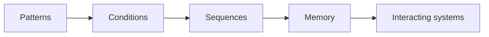

This is a progression direction, not a commitment to ship every system type in the first release.

### Phase 2 — Product Strategy & Definition

Phase 2 established Thinksy as a **single-player intellectual reasoning game** in which players investigate unfamiliar deterministic systems through controlled experiments.

The product mission is:

> **Make curiosity playable.**

The product promise is:

> **You are not given the rule. You discover it.**

The strategic decision is to build one coherent game whose depth comes from increasingly expressive systems, not a collection of unrelated mini-games.

The first product question remains whether players genuinely enjoy understanding an unfamiliar system by choosing experiments, inferring its rules and predicting what it will do next.

### Phase 3 — Product Design, UX/UI & Experience Architecture

Phase 3 turned the product direction into a concrete browser-first experience and reviewed the supplied implementation.

The core player loop is:

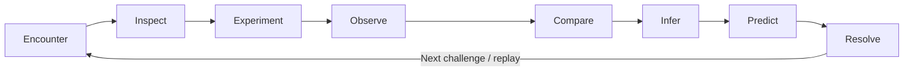

The challenge workspace is the centre of the experience. It brings together:

- **System:** what the player is investigating.
- **Input:** what the player can test.
- **Output:** what the system returns.
- **Experiment history:** the ordered evidence the player has collected.
- **Prediction:** the player's deliberate answer.

Phase 3 also established the five-round match, Practice / Classic / Time Trial modes, Easy / Medium / Hard difficulty, clue budgets, timers, scoring, results, profile, streaks, coins, cosmetics and leaderboard presentation.

The supplied QA report records 19 passing automated tests. That report is evidence from the supplied project artefact; it is not a new test run and does not establish production readiness or validated player enjoyment.

### Continuity matrix

| Established in earlier phases | Technical implication in Phase 4 |
|:--|:--|
| The player chooses experiments | Input submission must be a first-class server operation |
| Outputs must be consistent | Engine execution must be deterministic |
| Stateful reasoning is the leading thesis | Engine contract must support explicit state transitions |
| Experiment history is essential | Every accepted experiment must be ordered and durable |
| The hidden rule must remain hidden | Public and private challenge data must be separated |
| The player makes a deliberate prediction | Prediction must be a separate server-side operation |
| The match contains five rounds | Match and round state must be modelled explicitly |
| Difficulty changes clue and time constraints | Constraints must be configuration-driven and server-enforced |
| Scores and rewards must be understandable | Scoring and reward rules must be centralised and versioned |
| The interface is browser-first and responsive | No native app or heavy client rewrite is required to prove the core game |
| Player enjoyment is not yet validated | Instrumentation must support product learning, not vanity metrics |

---

We selected an architecture proportionate to the first release. It secures the core game without introducing infrastructure for scale or unvalidated features.

# 1. Architecture Principles & Non-Negotiable Invariants

The following principles govern every technical decision in this document.

| Principle | Architecture rule |
|:--|:--|
| **Determinism** | The same challenge version, initial state and ordered input sequence produce the same outputs and final state |
| **Server authority** | The browser never decides correctness, score, timer expiry, ownership or reward balance |
| **Evidence integrity** | Accepted experiments are stored in order and cannot silently disappear or be reordered |
| **Hidden-rule protection** | Private rules, answer sets and internal state are never included in player-facing responses before resolution |
| **Attempt isolation** | One player's attempt cannot mutate another attempt |
| **Reproducibility** | A completed attempt can be replayed from its immutable challenge version and recorded inputs |
| **Idempotency** | A network retry cannot apply the same experiment or purchase twice |
| **Atomicity** | State changes and their corresponding records commit together or not at all |
| **Challenge quality** | A challenge cannot be published solely because its JSON schema is valid |
| **Proportionality** | Do not introduce infrastructure without a demonstrated product or operational need |
| **Privacy by design** | Collect only the data needed to operate the game and understand its use |
| **Progressive extensibility** | Support richer challenge behaviour through explicit engine modules, not a general-purpose code execution platform |

### 1.1 The determinism contract

For a stateless system:

\[
y = f(x)
\]

For a stateful system:

\[
(s_{t+1}, y_t) = F(s_t, x_t)
\]

Where:

- \(s_t\) = authoritative internal state before the experiment.
- \(x_t\) = player input.
- \(y_t\) = observable output returned to the player.
- \(s_{t+1}\) = authoritative state after the experiment.

The fundamental contract is:

\[
\text{Challenge Version} + \text{Initial State} + \text{Ordered Inputs}
\Rightarrow
\text{Same Outputs and Final State}
\]

This is the most important correctness guarantee in Thinksy.

### 1.2 Trust boundaries

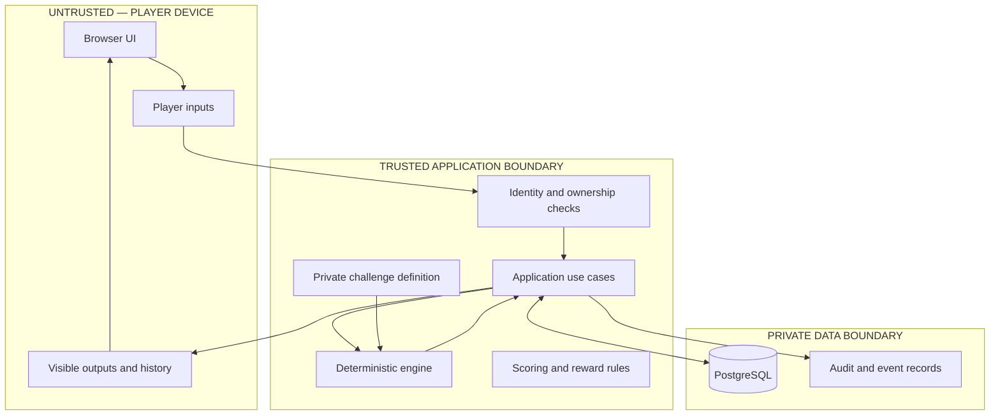

**Trust rule:** The browser is a presentation and input device. It is never the authority for game state.

---

# 2. Technical Feasibility & Existing-System Assessment

### 2.1 Current implementation baseline

Phase 3 reviewed the following project structure:

| File | Existing responsibility | Phase 5 direction |
|:--|:--|:--|
| `index.html` | HTML shell, viewport metadata, font loading and app entry point | Retain and refine |
| `styles.css` | Visual system, responsive layouts, components, animations and states | Retain; improve accessibility and component consistency |
| `app.js` | Client screens, game interaction, modal state, API calls and rendering | Retain initially; split into focused modules |
| `server.js` | HTTP server, game rules, scoring, timers, player data, rewards and routes | Refactor into modular application/domain/infrastructure layers |
| `package.json` | Project metadata, Node requirement and start/test scripts | Pin supported runtime and dependencies |
| `README.md` | Local setup, player flow and project guide | Update with architecture and deployment instructions |
| `QA_REPORT.md` | Feature summary and recorded automated test results | Extend with production acceptance evidence |
| `tests/app.test.js` | Automated HTTP, game-rule and frontend integration tests | Preserve and expand |
| `data/db.json` | Local JSON-backed player data | Development-only; migrate to PostgreSQL |
| Process memory | Active match/session map | Replace with durable database-backed match state |

The supplied README specifies Node.js 18 or newer and no third-party npm packages for the core server. The app is started through `npm start` and accessed through `http://localhost:3000`. The HTML file is not intended to be opened directly because the game depends on `/api/*` endpoints.

### 2.2 Current capability versus production gap

| Capability | Existing prototype evidence | Production gap |
|:--|:--|:--|
| Browser-first game | Implemented | Production hosting and delivery |
| Practice / Classic / Time Trial | Implemented | Centralised versioned configuration |
| Five-round match | Implemented | Durable lifecycle and recovery |
| Numeric experiments | Implemented | Generalised typed engine boundary |
| Experiment history | Implemented in active game | Durable ordered records |
| Prediction and result | Implemented | Versioned server evaluator and audit |
| Timers | Server-side logic documented | Durable deadline enforcement across restarts |
| Scoring | Server-side logic documented | Centralised, versioned and regression-protected rules |
| Profile and player stats | Local persistence | Production identity and relational storage |
| Google-branded sign-in | UI and profile association | Verified Google OIDC |
| Friends | Demo/configured route | Durable invitation and relationship lifecycle |
| Leaderboard | Friends/global presentation | Authoritative data and documented ranking policy |
| Coins and cosmetics | Local routes and calculations | Transaction ledger, atomic purchase and anti-abuse |
| Match state | In-memory map | PostgreSQL-backed recovery |
| Automated QA | Report records 19/19 passing | Production security, accessibility, load and recovery testing |
| Analytics | Not established as a complete pipeline | Privacy-aware event instrumentation |

### 2.3 Feasibility conclusion

The current prototype is a suitable starting point. It already demonstrates the player journey and core numeric gameplay. It does not need to be discarded or rewritten simply to adopt a more fashionable framework.

The main engineering work is to separate responsibilities, preserve the approved interface, isolate the game engine and replace prototype-only persistence and identity mechanisms.

### 2.4 Feasibility heat map

Legend: 🟢 straightforward with the adopted architecture · 🟡 requires careful engineering · 🔴 high-risk if attempted without additional design or validation.

| Capability | Feasibility | Main dependency |
|:--|:--:|:--|
| Preserve current browser UI | 🟢 | Regression testing |
| Extract current numeric rules into engine modules | 🟢 | Rule inventory and tests |
| Add PostgreSQL persistence | 🟡 | Schema, migrations and transaction design |
| Durable match recovery | 🟡 | Match lifecycle and deadline model |
| Verified Google OIDC | 🟡 | Provider configuration and token verification |
| Transactional coin economy | 🟡 | Ledger and idempotent purchases |
| Durable friend relationships | 🟡 | Identity and invitation model |
| Stateful challenge families | 🟡 | Explicit engine state and challenge authoring |
| General-purpose challenge scripting | 🔴 | Unbounded execution and validation risk; excluded from the selected architecture |
| AI-controlled authoritative gameplay | 🔴 | Conflicts with deterministic fairness; excluded |
| Real-time multiplayer | 🔴 | Not required by the current product thesis |

---

# 3. Selected Technology Stack

The stack is selected to strengthen the current implementation, not replace it without reason.

### 3.1 Final stack decision

| Layer | Adopted direction | Why it fits Thinksy |
|:--|:--|:--|
| Runtime | **Node.js LTS** | Existing backend is Node-based; one runtime for application and tests |
| Server language | **TypeScript, adopted progressively** | Safer domain contracts and explicit state/input/output types |
| HTTP/API layer | Modular REST API; retain the existing Node server during extraction; use a lightweight structured router when the route surface is refactored | Avoid a framework migration as a goal in itself |
| Frontend | **Existing vanilla HTML, CSS and JavaScript retained initially** | Preserves Phase 3 visual and interaction work |
| UI architecture | Small browser modules and explicit state/rendering boundaries | Enough structure without a full rewrite |
| Database | **PostgreSQL** | Relational integrity, transactions, indexes and JSONB where appropriate |
| Database access | Parameterised SQL through a maintained Node PostgreSQL client | Explicit transaction behaviour and predictable queries |
| Migrations | Version-controlled SQL migrations | Repeatable environment setup and safe schema evolution |
| Validation | Schema validation at every external boundary | API and challenge data are validated on the server |
| Authentication | Google OAuth 2.0 / OpenID Connect; guest-first entry | Secure identity without forcing sign-in before play |
| Session | Server-managed opaque session cookie | Revocation and durable session control |
| Testing | Node test runner or established test tooling; unit, integration and end-to-end layers | Preserve current tests and add domain-level coverage |
| Observability | Structured logs, metrics, traces and error monitoring | Diagnose slow or inconsistent gameplay |
| Hosting | Managed Node application runtime + managed PostgreSQL | Small operational footprint |
| CI/CD | Automated tests, migration checks, build and deployment gates | Prevent unsafe releases |

#### Runtime version policy

Use a **supported Node.js LTS release** at implementation time, pin it in the runtime configuration and CI pipeline, and review the Node.js release schedule before production deployment. As of this document's research date, Node.js 26 is listed as Active LTS; Node.js 27 is in Alpha and is not a production choice. Do not pin an Alpha line for production. See the [official Node.js release schedule](https://github.com/nodejs/Release).

### 3.2 Why We Retain the Current Frontend

Phase 3 already established a working browser interface, responsive behaviour, motion direction, typography and component structure. A React or Next.js rewrite adds migration work without addressing the main production risks; we retain the existing frontend.

We retain the existing frontend and organise it around these clear responsibilities:

- Screen/navigation state.
- Match setup and configuration.
- Game workspace state.
- Experiment history rendering.
- Prediction interaction.
- Result and progression rendering.
- Profile, leaderboard and shop presentation.
- API client and error handling.
- Shared UI components and design tokens.

A framework migration can be reconsidered if the frontend becomes difficult to maintain, needs complex shared state or requires a larger application surface. It is not a Phase 5 prerequisite.

### 3.3 TypeScript Adoption

The game engine and API boundaries benefit most from explicit types. We introduce TypeScript first at the boundaries where explicit contracts provide the greatest value:

1. Domain types and state models.
2. Challenge definitions.
3. Engine input/output contracts.
4. Experiment and prediction use cases.
5. API request/response schemas.
6. Persistence repositories.

The browser can remain JavaScript initially. Shared contracts can be introduced carefully without blocking the existing interface.

### 3.4 Why PostgreSQL

Thinksy's data is inherently relational:

- A player owns matches.
- A match contains rounds.
- A round references a challenge version.
- A round contains ordered experiments.
- A round has a prediction and result.
- A player has progress and, where enabled, a reward ledger and inventory.

PostgreSQL supports transactions, constraints, indexes and JSONB for structured-but-variable challenge payloads. Use relational columns for identity, ownership, status, timestamps and relationships. Use JSONB for challenge manifests, private challenge definitions and variable input/output payloads—not as a substitute for the relational model.

Reference: [PostgreSQL JSON Types](https://www.postgresql.org/docs/current/datatype-json.html).

### 3.5 Technology decision matrix

Scores are qualitative architecture-fit assessments, not benchmark measurements.

| Decision | Option | Fit | Decision |
|:--|:--|:--:|:--|
| Frontend | Retain vanilla HTML/CSS/JS | 🟩🟩🟩🟩🟩 | Adopt |
| Frontend | Rewrite in React/Next.js immediately | 🟨🟨 | Defer |
| Backend | Node.js modular monolith | 🟩🟩🟩🟩🟩 | Adopt |
| Backend | Microservices | 🟥 | Reject for first release |
| Language | Gradual TypeScript adoption | 🟩🟩🟩🟩🟩 | Adopt |
| Database | PostgreSQL | 🟩🟩🟩🟩🟩 | Adopt |
| Database | Local JSON file as production store | 🟥 | Reject |
| Cache | Redis from day one | 🟨 | Defer until justified |
| Hosting | Managed application + managed database | 🟩🟩🟩🟩🟩 | Adopt |
| Orchestration | Kubernetes | 🟥 | Defer |
| AI | LLM in the game engine | 🟥 | Reject |
| AI | Internal authoring/QA assistance | 🟩🟩🟩🟩 | Optional, gated |

---

# 4. System Architecture

### 4.1 Architecture overview

Thinksy uses a **modular monolith**: one application deployment with explicit internal modules and one PostgreSQL system of record.

This gives the product a clear separation of concerns without creating a distributed system that the current gameplay does not need.

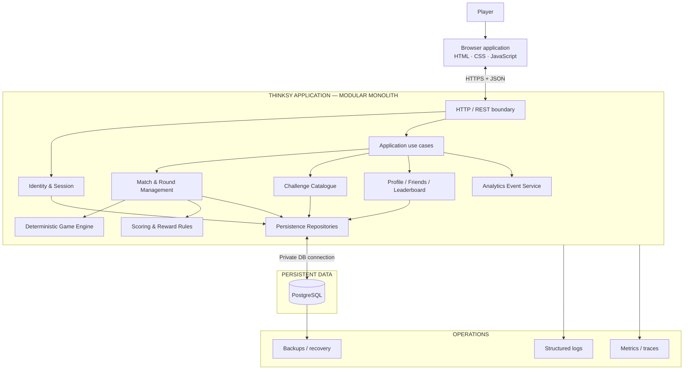

### 4.2 System context

The primary actor is a player using a browser. The browser communicates with the Thinksy application over HTTPS. The application executes the game engine and reads/writes PostgreSQL.

The game does not need an external AI service or third-party API to calculate a challenge result.

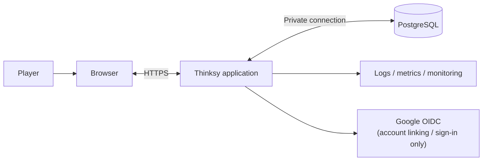

Google is an identity provider, not a gameplay dependency. If the player is using a guest session, the core game can operate without a Google login.

### 4.3 Deployment architecture

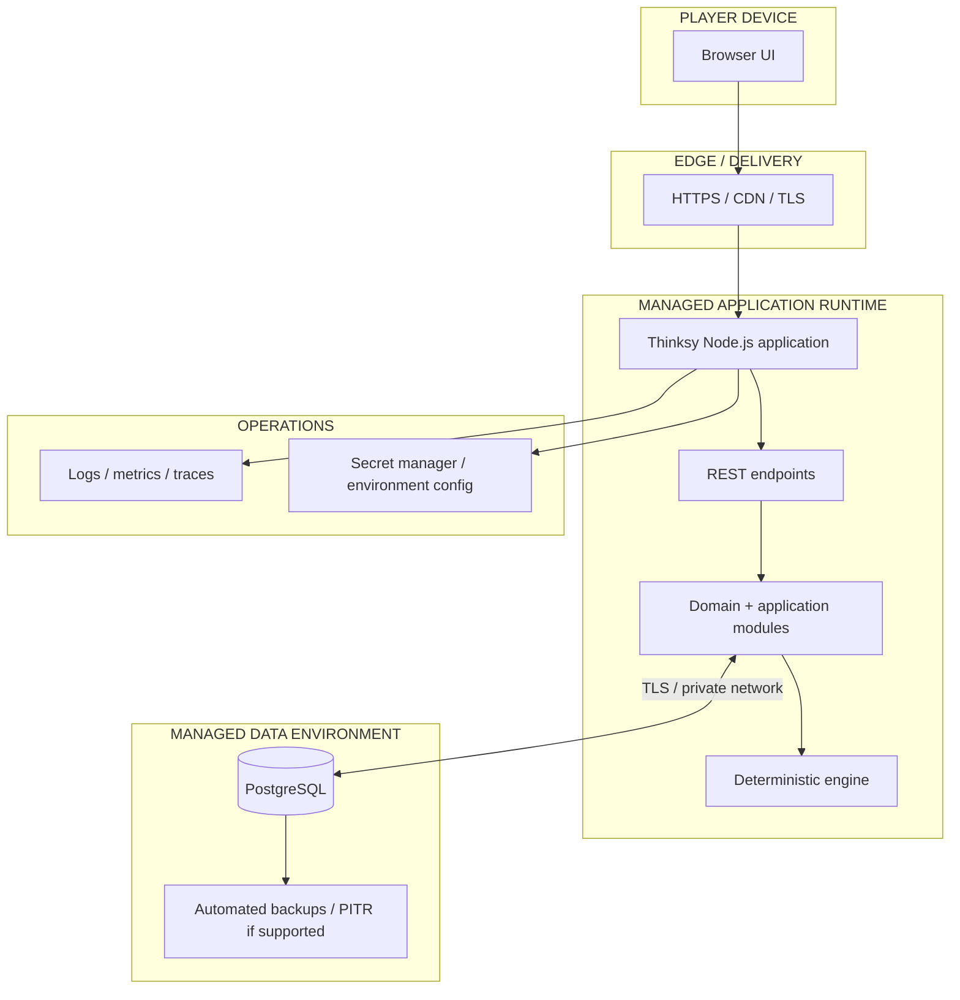

**Deployment boundary rules:**

- The browser never connects directly to PostgreSQL.
- The database is not exposed publicly unless the hosting provider requires a restricted connection; allow-list and TLS controls must be used.
- Database credentials, OAuth secrets and signing secrets are server-only.
- All authoritative match state is persisted; it is not held only in process memory.
- The application can run as one instance initially and more than one instance later without changing game correctness.
- Backups must be restorable, not merely configured.

### 4.4 Internal application layers

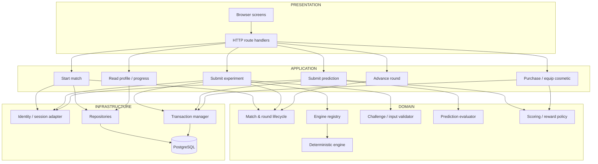

#### Layer responsibilities

| Layer | Owns | Must not own |
|:--|:--|:--|
| Presentation | Screens, interaction state, HTTP request/response mapping | Hidden rules, authoritative score, database access |
| Application | Use-case orchestration and transaction boundaries | Visual rendering |
| Domain | Match rules, engine, challenge validation, prediction and scoring logic | HTTP framework, SQL or hosting provider |
| Infrastructure | PostgreSQL, session storage, OAuth adapter, logs and monitoring | Product rule decisions |

### 4.5 Module ownership

| Module | Responsibility | Primary data ownership |
|:--|:--|:--|
| Identity | Guest sessions, Google identity association, player identity | Players, auth identities, sessions |
| Challenge Catalogue | Challenge metadata, versions, publication and retrieval | Challenges, challenge versions |
| Match Management | Match creation, round lifecycle, deadlines and completion | Matches, rounds |
| Experiment Execution | Input validation, idempotency, sequence control and engine invocation | Experiments, round state |
| Game Engine | Deterministic transitions and observable outputs | No direct database writes |
| Prediction Evaluation | Accepted answer evaluation and result explanation | Predictions |
| Scoring | Round points, match outcome and reward policy | Score snapshots / configuration |
| Player Progress | Personal best, streak, statistics and achievements | Player statistics, activity |
| Economy | Coin ledger, purchases and inventory | Ledger, catalogue, inventory |
| Social | Friend codes, invitations and relationships | Friendships |
| Leaderboard | Ranking projections and result queries | Ranking read model |
| Analytics | Server-side gameplay and product events | Analytics event store / sink |

These are logical modules inside one application. They do not require independent network services.

### 4.6 Why a modular monolith is the right choice

| Requirement | Modular monolith outcome |
|:--|:--|
| Small team / early product | Lower operational burden |
| Deterministic game engine | Engine can be isolated and unit-tested |
| Database transactions | One application transaction boundary |
| Future challenge types | Engine registry and versioned definitions |
| Multiple application instances | Shared durable state in PostgreSQL |
| Future service extraction | Module boundaries create a path without requiring extraction now |

**Do not introduce microservices, Kubernetes, a message broker or a service mesh for the first production release.** Reconsider only when measured traffic, team ownership, isolation or workload requirements justify them.

---

### 4.7 Third-party integrations and system boundaries

Thinksy keeps external dependencies outside the deterministic game engine. Every provider is accessed through a narrow adapter owned by the application layer. Provider-specific payloads do not become domain models.

| Integration | Purpose | Data exchanged | Authority and control | Phase 4 decision |
|:--|:--|:--|:--|:--|
| Google OpenID Connect | Optional persistent player identity | Authorization code, verified identity claims | Identity adapter validates issuer, audience, signature, expiry, nonce and state; stable `sub` is the provider identifier | Adopt for account sign-in |
| Managed PostgreSQL | Durable application data | SQL transactions and query results | Application services own domain writes; database constraints enforce integrity | Adopt as system of record |
| Hosting / cloud runtime | Serve the application and scheduled operational tasks | HTTP traffic, deployment artifacts, configuration | Environment isolation, TLS, restricted network access and managed secrets | Managed application hosting |
| Monitoring / error reporting | Operational diagnostics | Redacted logs, metrics, traces and error context | No secrets, hidden challenge definitions or unnecessary personal data | Provider selected during deployment against the requirements in this phase |
| Email delivery | Account or operational messages, if enabled by product scope | Minimal recipient and message metadata | Provider adapter; delivery failure cannot mutate game state | Not required for core gameplay; no provider is assumed |
| Payment provider | No external payment flow is part of the approved virtual-coin architecture | Not applicable | Coin purchases in the current scope are internal ledger transactions, not a real-money payment integration | Not selected or represented as integrated |

No external integration is allowed to calculate challenge outputs, mutate authoritative game state, decide prediction correctness or award virtual currency.

**Integration contract:** each adapter has explicit input/output types, timeout behaviour, retry policy, error mapping, secret ownership and test doubles. Provider failures are contained at the adapter boundary. Authentication callbacks are validated server-side. External calls are never made inside the pure engine transition.

### 4.8 Cloud and deployment architecture

The cloud deployment is a managed, single-region application architecture for the first release:

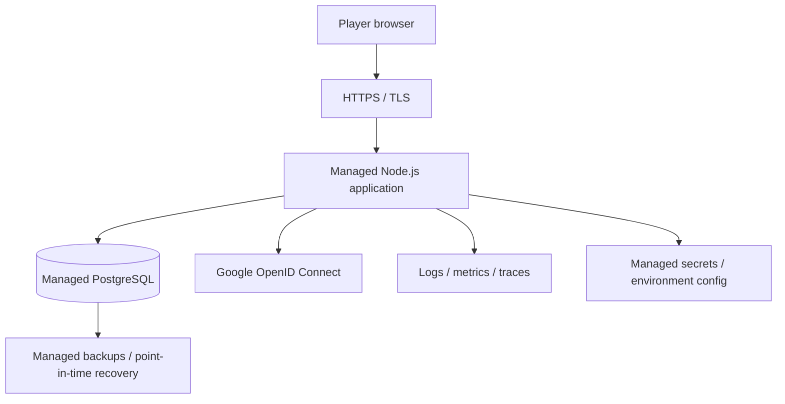

The application and database are separate managed resources. PostgreSQL is not publicly exposed. The application connects through the provider's private network or restricted connection path with TLS and least-privilege credentials. Secrets are injected at runtime and never embedded in frontend assets or committed to source control.

The initial deployment does not require Kubernetes, service mesh, distributed queues, a vector database or GPU infrastructure. Static frontend assets may be served by the application or a compatible static delivery layer; this does not change the API or domain boundaries.

The selected provider and region are deployment decisions constrained by data residency, managed PostgreSQL support, backup capability, network security, observability, availability, exportability and total operating cost. Provider selection is recorded as an ADR before production credentials or personal data are introduced.

# 5. Deterministic Game Engine Architecture

### 5.1 The engine is the product's technical core

Thinksy's central experience depends on the system behaving consistently. The engine must be isolated from the UI, HTTP framework, session management and database.

The engine accepts a challenge definition, an authoritative state and a player input. It returns the next state and the observable output.

```ts
type EngineInput = {
  challengeVersion: number;
  state: unknown;
  input: unknown;
};

type EngineResult = {
  nextState: unknown;
  observableOutput: unknown;
};

function executeExperiment(
  definition: PrivateChallengeDefinition,
  state: EngineInput["state"],
  input: EngineInput["input"]
): EngineResult;
```

This contract defines the engine boundary. The implementation uses explicit typed state and payload contracts for each supported engine family; `unknown` is not accepted as a production domain contract.

### 5.2 Engine execution model

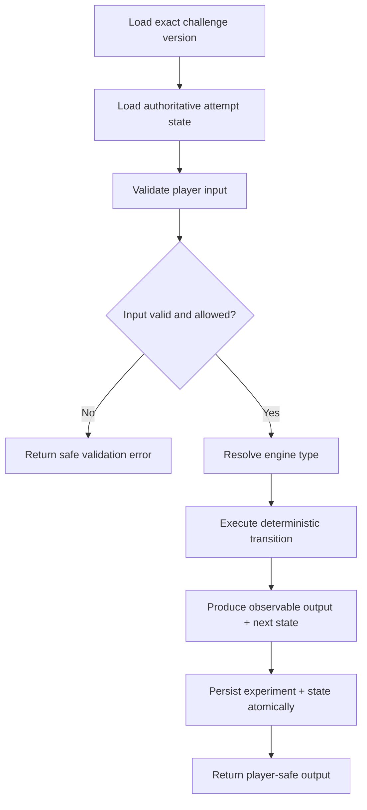

### 5.3 Determinism requirements

The engine must not depend on uncontrolled variation.

| Uncontrolled source | Rule |
|:--|:--|
| Unseeded randomness | Prohibited in challenge execution |
| Current system time | Not an implicit challenge input |
| External API response | Not allowed in engine transition |
| Shared mutable global state | Prohibited |
| Browser-provided state | Never authoritative |
| Unstable ordering | Explicitly define ordering for collections and operations |
| Floating-point ambiguity | Prefer integer/decimal-safe rules or explicit tolerance |
| Runtime environment differences | Pin runtime and test deterministic replay |

If a future challenge requires randomness, the seed must be explicit, persisted and included in the replay inputs.

### 5.4 Pure execution and side effects

The transition function is pure: it calculates the result, while the application layer handles persistence and other side effects.

The engine must not:

- Write to PostgreSQL.
- Read cookies or session state.
- Call a third-party API.
- Update player statistics.
- Award coins.
- Render UI.
- Return private state to the browser.

This separation allows the engine to be tested independently and makes replay reliable.

### 5.5 Engine families and progression

The product thesis describes a progression from patterns to conditions, sequences, memory and interacting systems. The initial production engine is intentionally limited to the challenge categories required by the curated release; future categories remain outside the current scope.

| Engine family | Behaviour | Release status |
|:--|:--|:--|
| Numeric transformation | Fixed input-to-output rule | Current prototype baseline |
| Conditional transformation | Output depends on input conditions | Supported direction; add when challenge set requires it |
| Sequence engine | Order of inputs affects output | Future extension |
| Stateful engine | Previous inputs update hidden state | Strategic thesis; requires dedicated challenge design |
| Composite engine | Two or more deterministic rules interact | Later extension after simpler families validate |

The engine registry contains only the engine types required by the curated challenge set. We add an engine family only when a concrete, approved challenge requires it.

### 5.6 State isolation

Every round/attempt has its own state snapshot. The engine receives that state explicitly.

A transition in one attempt cannot mutate another attempt. No global object, singleton or in-memory map may hold authoritative per-player state.

### 5.7 Replay and verification

An attempt can be reconstructed from:

1. The immutable challenge version.
2. The initial state.
3. The accepted inputs in sequence order.
4. The engine version compatible with that challenge.

Replay must reproduce every recorded output and the final state.

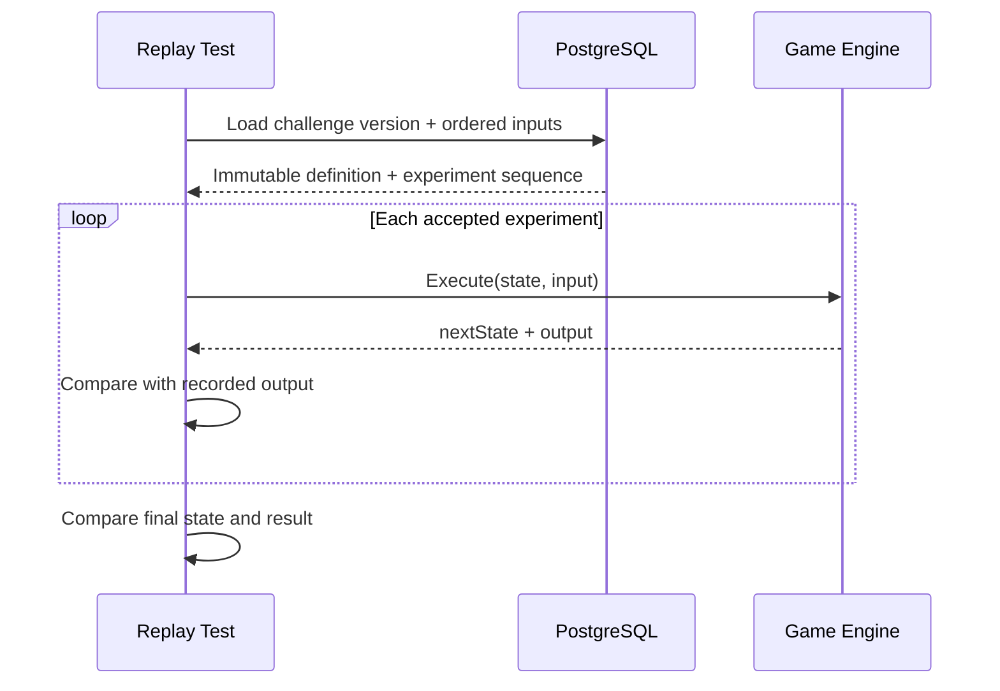

Full event sourcing is not required. An ordered experiment log plus reproducible engine is sufficient for the current product.

### 5.8 Engine test matrix

| Test | Expected result |
|:--|:--|
| Same challenge + same state + same input | Same output and next state |
| Same ordered input sequence replayed | Same output sequence and final state |
| Same inputs in a different order on a stateful engine | Only the defined deterministic result; order must be preserved |
| Invalid input | No state mutation |
| Unsupported engine type | Challenge cannot be published |
| Missing state field | Controlled validation failure |
| One attempt executes | No other attempt state changes |
| Engine version changes | Historical challenge remains replayable using compatible engine version |

---

# 6. Challenge Definition & Content Architecture

### 6.1 Why challenges need a formal model

A challenge is not merely a title and a hidden answer. It is a deterministic system with a defined input space, behaviour, constraints, prediction rule and explanation.

Challenge-specific `if` statements inside the HTTP server create a testing and maintenance bottleneck as the catalogue grows; engine behaviour therefore lives in isolated modules.

Challenge definitions must be structured, validated and versioned.

### 6.2 Public and private challenge data

Two data projections are required.

#### Public manifest

May be delivered to the browser:

- Challenge ID and version label.
- Title and introduction.
- Objective and instructions.
- Input format and visible constraints.
- Public difficulty and category.
- Display configuration.
- Permitted player-facing hints, if the challenge supports them.

#### Private definition

Must remain server-side:

- Initial internal state.
- Hidden transformation or transition configuration.
- Private input constraints.
- Engine type and engine configuration.
- Prediction evaluation policy.
- Accepted answer set.
- Completion conditions.
- Explanation that is revealed only at the allowed point.
- Challenge validation metadata.

**Never return a private challenge object and rely on the frontend to hide its properties.** The API must construct an explicit public DTO.

### 6.3 Illustrative challenge definition

```json
{
  "challengeId": "signal-chamber-001",
  "version": 1,
  "engineType": "numeric-transform",
  "engineVersion": "1",
  "publicManifest": {
    "title": "The Signal Chamber",
    "objective": "Discover how the machine transforms a signal.",
    "inputType": "integer",
    "allowedInputs": {
      "minimum": 1,
      "maximum": 16
    },
    "predictionTarget": 17
  },
  "privateDefinition": {
    "initialState": {},
    "ruleReference": "private-rule-001",
    "evaluation": {
      "type": "exact-match"
    }
  },
  "constraints": {
    "maxExperiments": 7,
    "allowDuplicateInputs": false,
    "minimumExperimentsBeforePrediction": 1
  },
  "publication": {
    "status": "published",
    "reviewed": true
  }
}
```

This is a schema illustration, not a literal production challenge or a disclosure of a live hidden rule.

### 6.4 Challenge lifecycle


### 6.5 Publication quality gates

A challenge cannot be published merely because the JSON is valid.

| Quality gate | What must be proven |
|:--|:--|
| Schema validity | Required fields and data types are valid |
| Engine compatibility | The engine type and version exist |
| Determinism | Repeated execution produces identical results |
| Input validity | Valid and invalid input boundaries behave correctly |
| State reachability | Required states can be reached |
| Solvability | The intended answer can be inferred from permitted evidence |
| Uniqueness / accepted solutions | Valid answers are explicitly defined |
| Ambiguity | No unintended alternative rule fits all evidence |
| Explanation integrity | The explanation matches actual engine behaviour |
| Difficulty review | Clue and timer constraints are appropriate for the intended level |
| Resource bounds | Execution remains within defined limits |
| Human review | A reviewer approves the player-facing challenge |

### 6.6 Challenge versioning

Published challenge versions are immutable.

If a challenge requires correction:

- Create a new version.
- Preserve the old version for historical attempts.
- Keep each active round tied to the version it started with.
- Record the engine version required to replay it.
- Do not silently change a live challenge's hidden rule.

### 6.7 Current numeric challenge baseline

The Phase 3 implementation review documents four authored rules per difficulty and a numeric Signal Chamber.

- Inputs are numeric values 1 through 16.
- Each input can be tested once per round.
- The target prediction is input 17.
- At least one experiment is required before prediction.
- The server selects a rule from the difficulty-specific set.
- The active public payload must not expose the hidden rule.
- The answer and rule title are returned after the round resolves.

The authored families documented in Phase 3 are:

| Difficulty | Rule title | Documented transformation |
|:--|:--|:--|
| Easy | The double signal | \(2n\) |
| Easy | The offset machine | \(n + 5\) |
| Easy | The triple pulse | \(3n\) |
| Easy | The odd sequence | \(2n + 1\) |
| Medium | The compound signal | \(3n + 2\) |
| Medium | The square shift | \(n^2 + 1\) |
| Medium | The rising offset | \(2n + 3\) for odd inputs; \(2n + 1\) for even inputs |
| Medium | The weighted sequence | \(4n - 3\) |
| Hard | The quadratic chamber | \(n^2 + 2n + 1\) |
| Hard | The cubic signal | \(n^3 - 2n\) |
| Hard | The modular cycle | Formula as recorded in Phase 3; verify against `server.js` before migration |
| Hard | The compound growth | \(2n^2 + 3n + 1\) |

**Migration rule:** The canonical rule implementations remain the source of truth. The implementation handoff records the required extraction and regression checks; the modular-cycle expression is not promoted into the production catalogue until it matches the executable source and passes those checks.

---

# 7. Match, Round & Experiment Lifecycle

### 7.1 Match configuration

The Phase 3 experience is preserved.

| Mode | Difficulty | Clues per round | Timer | Match structure |
|:--|:--|--:|:--:|:--|
| Practice | Easy, enforced | 7 | None | Five rounds |
| Classic | Player-selected Easy / Medium / Hard | 7 / 10 / 15 | 180 / 120 / 90 seconds | Five rounds |
| Time Trial | Hard, enforced | 15 | 90 seconds | Five rounds |

The server enforces the mode/difficulty mapping. The browser can request a mode and difficulty, but the server validates and normalises the final configuration.

### 7.2 Scoring policy

The Phase 3 scoring rules remain the product baseline.

| Outcome | Condition | Round points |
|:--|:--|--:|
| Efficient correct prediction | Correct within the efficient clue threshold | 1.0 |
| Later correct prediction | Correct after the efficient threshold but within clue budget | 0.5 |
| Incorrect prediction | Wrong output selected | 0 |
| Timeout | Server deadline expires before resolution | 0 |

Efficient thresholds:

| Difficulty | Clue budget | Full-point threshold |
|:--|--:|--:|
| Easy | 7 | 3 |
| Medium | 10 | 5 |
| Hard | 15 | 7 |

Match result:

- Five rounds.
- Maximum score: 5.0.
- Win: final score greater than or equal to 3.0.
- Loss: final score below 3.0.

**These rules are part of the approved product contract.** Scoring configuration is centralised and versioned; it is not duplicated across client and server code.

### 7.3 State machine

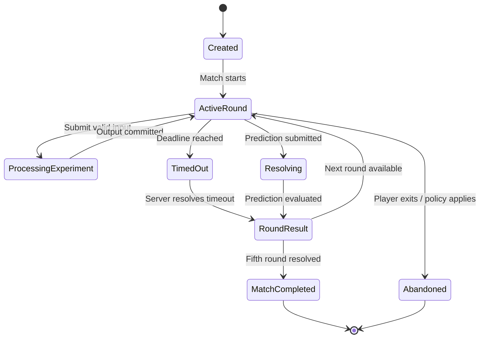

The client can request a transition, but the server validates whether the transition is allowed.

### 7.4 Timer authority

The server stores `started_at` and `deadline_at` for each timed round.

- The browser countdown is a visual representation.
- The server clock determines expiry.
- A submitted prediction is valid only if it arrives before the server deadline under the defined request-time policy.
- If a request arrives after expiry, the server resolves the timeout and returns the completed round state.
- The browser cannot extend the timer by changing its local clock.
- The next round receives a new deadline.
- Practice rounds have no deadline.

A separate timer worker is not required initially. Expiry can be resolved transactionally when a relevant request or state read discovers that the deadline has passed. If later product requirements demand exact background resolution independent of player requests, add a small scheduled worker without changing the domain rules.

### 7.5 Experiment submission lifecycle

```mermaid
sequenceDiagram
    actor Player
    participant UI as Browser UI
    participant API as Thinksy API
    participant App as Experiment Use Case
    participant DB as PostgreSQL
    participant Engine as Game Engine

    Player->>UI: Select input and submit
    UI->>API: POST experiment + idempotency key
    API->>App: SubmitExperiment
    App->>DB: Begin transaction; lock round
    DB-->>App: Owner, status, deadline, sequence, state
    App->>App: Validate ownership, status, clue budget and input
    App->>Engine: Execute exact challenge version
    Engine-->>App: Next state + visible output
    App->>DB: Insert experiment; update state and sequence
    App->>DB: Commit
    App-->>API: Player-safe result
    API-->>UI: Output + sequence + remaining clues
    UI-->>Player: Append evidence to history
```

### 7.6 Transaction and concurrency rules

The following changes must be atomic:

1. Verify the active round and expected sequence.
2. Verify the idempotency key.
3. Validate the input.
4. Execute the deterministic transition.
5. Insert the experiment record.
6. Update the authoritative state snapshot.
7. Increment the next sequence number.
8. Commit.

If any step fails, the transaction rolls back.

Use row-level locking or optimistic concurrency with a version column. Two simultaneous requests cannot both execute against the same previous state.

### 7.7 Idempotency

Every experiment submission carries a unique idempotency key scoped to the round.

| Situation | Required behaviour |
|:--|:--|
| Same key + same payload | Return the original committed result |
| Same key + different payload | Reject with conflict |
| New key + expected sequence | Process normally |
| New key + stale sequence | Reject or return current authoritative state |
| Client loses response after commit | Retry returns the committed result |

Use the same principle for purchases and other balance-changing operations.

### 7.8 Prediction lifecycle

```mermaid
sequenceDiagram
    actor Player
    participant UI as Browser
    participant API as Thinksy API
    participant App as Prediction Use Case
    participant DB as PostgreSQL
    participant Eval as Prediction Evaluator

    Player->>UI: Select candidate and lock in
    UI->>API: POST prediction
    API->>App: SubmitPrediction
    App->>DB: Begin transaction; lock round
    DB-->>App: Owner, status, deadline, challenge version
    App->>App: Validate prediction eligibility
    App->>DB: Load private evaluation definition
    DB-->>App: Private rule and accepted answer policy
    App->>Eval: Evaluate prediction
    Eval-->>App: Correctness + result explanation key
    App->>App: Calculate points and match status
    App->>DB: Save prediction, score and round status
    App->>DB: Commit
    App-->>API: Player-safe result
    API-->>UI: Result + permitted explanation + score
    UI-->>Player: Show round result
```

The private answer is not delivered to the browser until the round has resolved and the product permits the explanation to be revealed.

---

# 8. Identity, Authentication & Session Architecture

### 8.1 Guest-first product entry

The product strategy prioritises testing the core game. Account creation is not a prerequisite for the first experiment.

The adopted identity model is:

- A player can begin with a guest session.
- A guest can complete a match without connecting a Google account.
- An optional account-linking flow can associate a guest profile with a verified Google identity.
- The player experience explains what is retained in a guest session and what becomes portable after account linking.
- Account linking must not silently discard existing progress.

This preserves a low-friction first play while enabling persistent profiles, streaks, friend relationships and cross-device continuity.

### 8.2 Google OAuth 2.0 / OpenID Connect

The existing Google-branded UI is retained as the presentation reference. The current prototype's profile association is not verified OAuth.

Production sign-in must use a real OpenID Connect flow and server-side token verification.

Required controls:

1. Use the Authorization Code flow with PKCE where applicable.
2. Use exact registered redirect URIs.
3. Bind the login transaction to state and nonce.
4. Verify the token signature using Google's published keys.
5. Verify issuer, audience and expiry.
6. Use Google's stable `sub` claim as the external identity key.
7. Do not use a client-submitted name or email as proof of identity.
8. Create or associate the Thinksy player record only after successful verification.
9. Never store raw access tokens or ID tokens in browser local storage.
10. Keep provider secrets on the server.

Google's documentation explicitly requires server-side ID-token validation and recommends using the stable `sub` claim as the unique Google account identifier. The IETF's OAuth 2.0 Security Best Current Practice (RFC 9700) provides current security guidance for redirect-based OAuth flows.

References: [Google OpenID Connect](https://developers.google.com/identity/openid-connect/openid-connect) · [Google server-side ID token verification](https://developers.google.com/identity/gsi/web/guides/verify-google-id-token) · [RFC 9700](https://www.rfc-editor.org/rfc/rfc9700.html).

### 8.3 Session model

Use a server-managed opaque session identifier.

Cookie requirements:

- `HttpOnly`
- `Secure` in production
- `SameSite=Lax` unless a documented cross-site requirement needs another setting
- Restricted path and domain
- Rotation after sign-in or privilege changes
- Expiry and revocation support

The database stores a hash of the session token, not the raw bearer value.

### 8.4 Identity lifecycle

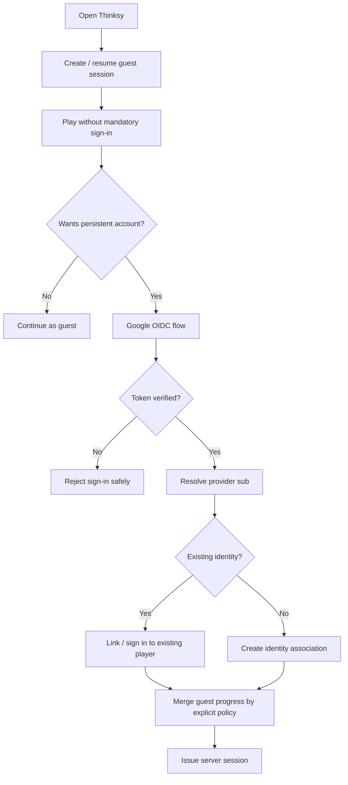

### 8.5 Guest-to-account merge policy

Account linking requires a defined merge policy. The system must not merge by email alone or silently overwrite an existing account.

The account-linking policy is governed by these requirements:

- Which guest data is eligible to transfer.
- How duplicate player identities are handled.
- Whether the guest profile becomes an alias or is retired.
- How conflicting streaks, personal bests and balances are resolved.
- How to prevent duplicate reward grants during merge.
- How the player is informed before the merge is finalised.

---

# 9. Data Architecture & Relational Model

### 9.1 Data design principles

- Relational data for identity, ownership, lifecycle and financial-like ledgers.
- JSONB for flexible challenge manifests and variable input/output payloads.
- Immutable challenge versions.
- Ordered experiment records.
- Explicit foreign keys and uniqueness constraints.
- Transactions for state-changing operations.
- Derived statistics where practical; avoid duplicated values that drift.
- Separate analytics events from authoritative game records.
- Never persist secrets in player-facing records.

### 9.2 Core entities

| Entity | Purpose | Required relationship |
|:--|:--|:--|
| `players` | Thinksy player identity and profile | Owns matches and progress |
| `auth_identities` | External identity provider association | Belongs to a player |
| `player_sessions` | Server-managed guest/account sessions | Belongs to a player or guest identity |
| `challenges` | Stable challenge identity | Has versions |
| `challenge_versions` | Immutable public/private challenge definition | Belongs to a challenge |
| `matches` | Five-round match lifecycle | Belongs to a player |
| `match_rounds` | One challenge round in a match | Belongs to a match and challenge version |
| `experiments` | Ordered accepted input/output record | Belongs to a round |
| `predictions` | Player's committed prediction and evaluation | Belongs to a round |
| `player_statistics` | Derived profile and performance summary | Belongs to a player |
| `daily_activity` | Daily activity and streak derivation | Belongs to a player |
| `coin_ledger` | Immutable coin transactions | Belongs to a player |
| `cosmetic_catalog` | Available themes, avatars and badges | Referenced by inventory |
| `player_inventory` | Items owned and equipped | Belongs to a player |
| `friendships` | Accepted relationship state | Links two players |
| `friend_invitations` | Pending friend-code invitation | Links inviter and invitee |
| `analytics_events` | Product usage events | Optional player/session association |

### 9.3 Entity relationship diagram

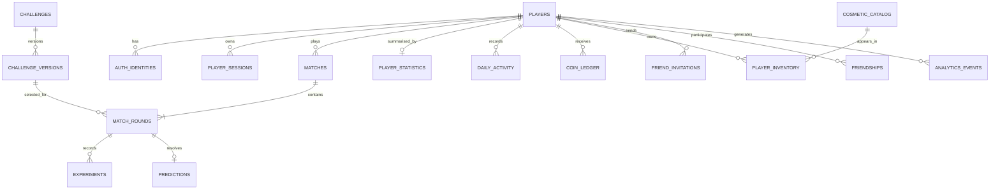

### 9.4 Key table design

#### `players`

| Field | Type / rule | Purpose |
|:--|:--|:--|
| `id` | UUID primary key | Internal player identity |
| `display_name` | Text, bounded length | Player-facing name |
| `avatar_key` | Nullable text | Selected avatar |
| `created_at` | Timestamp with time zone | Creation |
| `updated_at` | Timestamp with time zone | Last update |
| `status` | Enum/check | Active, suspended, deleted/pending deletion |

#### `auth_identities`

| Field | Type / rule | Purpose |
|:--|:--|:--|
| `id` | UUID primary key | Identity association |
| `player_id` | FK to players | Thinksy account |
| `provider` | Text | `google` initially |
| `provider_subject` | Text | Stable provider `sub` |
| `email_snapshot` | Nullable text | Display/contact snapshot only |
| `email_verified` | Boolean | Provider verification result |
| `created_at` | Timestamp | Association time |

Unique constraint: `(provider, provider_subject)`.

#### `player_sessions`

| Field | Type / rule | Purpose |
|:--|:--|:--|
| `id` | UUID primary key | Session record |
| `player_id` | FK, nullable only for a defined guest policy | Session owner |
| `token_hash` | Unique text / binary hash | Hashed opaque session token |
| `created_at` | Timestamp | Session creation |
| `expires_at` | Timestamp | Session expiry |
| `revoked_at` | Nullable timestamp | Revocation |
| `last_seen_at` | Timestamp | Session activity |

#### `challenges`

| Field | Type / rule | Purpose |
|:--|:--|:--|
| `id` | UUID primary key | Stable challenge identity |
| `slug` | Unique text | Human-readable identifier |
| `status` | Enum/check | Draft, published, archived |
| `created_at` | Timestamp | Creation |

#### `challenge_versions`

| Field | Type / rule | Purpose |
|:--|:--|:--|
| `id` | UUID primary key | Immutable version identity |
| `challenge_id` | FK | Parent challenge |
| `version_number` | Integer | Version sequence |
| `engine_type` | Text | Engine registry key |
| `engine_version` | Text | Compatible engine version |
| `public_manifest` | JSONB | Player-safe metadata |
| `private_definition` | JSONB | Server-only rules/state/evaluation |
| `definition_hash` | Text | Integrity fingerprint |
| `status` | Enum/check | Draft, published, retired |
| `published_at` | Nullable timestamp | Publication time |

Unique constraint: `(challenge_id, version_number)`.

Published versions are immutable at the application layer and protected by database permissions/trigger policy where practical.

#### `matches`

| Field | Type / rule | Purpose |
|:--|:--|:--|
| `id` | UUID primary key | Match identity |
| `player_id` | FK | Owner |
| `mode` | Enum/check | Practice, Classic, Time Trial |
| `difficulty` | Enum/check | Easy, Medium, Hard |
| `status` | Enum/check | Created, active, completed, abandoned |
| `current_round_number` | Integer | 1–5 |
| `score_total` | Numeric | Server-calculated score |
| `scoring_version` | Text/integer | Rule version |
| `started_at` | Timestamp | Start |
| `completed_at` | Nullable timestamp | Completion |
| `last_activity_at` | Timestamp | Recovery/retention |

#### `match_rounds`

| Field | Type / rule | Purpose |
|:--|:--|:--|
| `id` | UUID primary key | Round identity |
| `match_id` | FK | Parent match |
| `round_number` | Integer | 1–5 |
| `challenge_version_id` | FK | Exact immutable challenge |
| `status` | Enum/check | Active, completed, timed out |
| `clue_budget` | Integer | Server-defined budget |
| `clues_used` | Integer | Server-calculated count |
| `started_at` | Timestamp | Start |
| `deadline_at` | Nullable timestamp | Server deadline |
| `completed_at` | Nullable timestamp | Resolution |
| `round_score` | Numeric | Server-calculated points |
| `state_snapshot` | JSONB | Private authoritative state |
| `state_version` | Integer | Concurrency/replay marker |

Unique constraint: `(match_id, round_number)`.

#### `experiments`

| Field | Type / rule | Purpose |
|:--|:--|:--|
| `id` | UUID primary key | Experiment identity |
| `round_id` | FK | Parent round |
| `sequence_number` | Integer | Ordered position |
| `idempotency_key` | Text | Request de-duplication |
| `input_payload` | JSONB | Validated player input |
| `output_payload` | JSONB | Player-visible output |
| `state_version_after` | Integer | Resulting state version |
| `created_at` | Timestamp | Accepted time |

Unique constraints:
- `(round_id, sequence_number)`
- `(round_id, idempotency_key)`

#### `predictions`

| Field | Type / rule | Purpose |
|:--|:--|:--|
| `id` | UUID primary key | Prediction identity |
| `round_id` | Unique FK | One final prediction per round under current policy |
| `submitted_payload` | JSONB | Player's committed answer |
| `is_correct` | Boolean | Server evaluation |
| `evaluation_version` | Text | Evaluator version |
| `submitted_at` | Timestamp | Submission |
| `resolved_at` | Timestamp | Resolution |

If the product later allows multiple guesses, change the one-to-one policy through a versioned product decision and migration.

### 9.5 Relationship and integrity constraints

- A match belongs to exactly one player identity.
- A round belongs to exactly one match.
- A round references exactly one immutable challenge version.
- A round number is unique within a match.
- An experiment sequence number is unique within a round.
- An idempotency key is unique within its round.
- A prediction is accepted only for an active round.
- A completed round cannot accept another experiment or prediction.
- A purchase cannot create a negative coin balance.
- A cosmetic inventory item cannot be duplicated where the catalogue defines unique ownership.
- A friendship cannot be duplicated or self-referential.

### 9.6 Index strategy

| Table | Index | Reason |
|:--|:--|:--|
| `auth_identities` | `(provider, provider_subject)` unique | Identity lookup |
| `player_sessions` | `(token_hash)` unique; `(expires_at)` | Session validation and cleanup |
| `matches` | `(player_id, started_at DESC)` | Match history |
| `matches` | `(status, last_activity_at)` | Active/abandoned match operations |
| `match_rounds` | `(match_id, round_number)` unique | Round lookup |
| `experiments` | `(round_id, sequence_number)` unique | Ordered history |
| `experiments` | `(round_id, idempotency_key)` unique | Retry safety |
| `coin_ledger` | `(player_id, created_at DESC)` | Balance history |
| `friendships` | Unique canonical player pair | Relationship integrity |
| `analytics_events` | `(event_name, occurred_at)` | Event analysis |

Indexes must be validated against actual query plans and production data. Do not index every JSONB field by default.

### 9.7 State snapshot versus replay

Use both a current state snapshot and an ordered experiment log.

- The state snapshot makes active-round loading efficient.
- The experiment log makes the attempt auditable and reproducible.
- The engine version and challenge version make replay meaningful.
- Automated replay tests verify that the snapshot matches the experiment history.

This is a practical alternative to full event sourcing.

---

# 10. API Architecture & Contracts

### 10.1 API principles

- REST/JSON.
- Server-authoritative domain operations.
- Explicit request and response schemas.
- Stable machine-readable error codes.
- Object-level ownership checks on every resource operation.
- Idempotency for retryable state-changing requests.
- No private challenge fields in public response DTOs.
- API versioning when compatibility requirements justify it; challenge versioning is mandatory from the beginning.

### 10.2 API Endpoint Map

| Method | Endpoint | Purpose |
|:--|:--|:--|
| `GET` | `/api/v1/health` | Liveness |
| `GET` | `/api/v1/ready` | Readiness, including database connectivity |
| `GET` | `/api/v1/me` | Current player/session |
| `POST` | `/api/v1/auth/google` | Verify Google credential and establish session |
| `POST` | `/api/v1/auth/logout` | Revoke session |
| `GET` | `/api/v1/challenges` | List published public manifests |
| `GET` | `/api/v1/challenges/{id}` | Retrieve public challenge details |
| `POST` | `/api/v1/matches` | Create a five-round match |
| `GET` | `/api/v1/matches/{id}` | Retrieve authoritative match state |
| `POST` | `/api/v1/matches/{id}/rounds/{roundId}/experiments` | Submit experiment |
| `POST` | `/api/v1/matches/{id}/rounds/{roundId}/prediction` | Submit final prediction |
| `POST` | `/api/v1/matches/{id}/advance` | Advance after server-resolved round |
| `POST` | `/api/v1/matches/{id}/abandon` | Abandon active match |
| `GET` | `/api/v1/profile` | Player statistics and progress |
| `GET` | `/api/v1/leaderboard` | Friends/global read model, when enabled |
| `GET` | `/api/v1/shop` | Catalogue, balance and inventory |
| `POST` | `/api/v1/shop/purchases` | Purchase cosmetic item |
| `POST` | `/api/v1/shop/equipped-item` | Equip owned item |
| `POST` | `/api/v1/friend-invitations` | Create/send friend invitation |
| `POST` | `/api/v1/friend-invitations/{id}/accept` | Accept invitation |

The API contract defines the domain operations and security rules. Route naming remains an implementation detail and cannot change those contracts.

### 10.3 Legacy route mapping

We migrate the existing prototype routes without changing the player's mental model.

| Existing route | Domain operation |
|:--|:--|
| `/api/match` | `POST /api/v1/matches` |
| `/api/move` | `POST .../experiments` |
| `/api/guess` | `POST .../prediction` |
| `/api/next` | `POST /api/v1/matches/{id}/advance` |
| `/api/timeout` | Server-side deadline resolution; not trusted as a client assertion |
| `/api/exit` | `POST /api/v1/matches/{id}/abandon` |
| `/api/auth/google` | Verified OIDC credential validation |
| `/api/friends/add` | Durable invitation creation and acceptance |
| `/api/shop/purchase` | Transactional purchase operation |
| `/api/shop/equip` | Inventory-checked equip operation |

### 10.4 Experiment request

```json
{
  "input": {
    "value": 4
  },
  "expectedSequence": 3
}
```

Header:

```http
Idempotency-Key: 4d7c7a3c-unique-per-submission
```

The request must not contain authoritative internal state, hidden challenge configuration or a client-calculated output.

### 10.5 Experiment response

```json
{
  "experimentId": "uuid",
  "sequence": 3,
  "output": {
    "value": 8
  },
  "cluesUsed": 3,
  "cluesRemaining": 4,
  "roundStatus": "active"
}
```

The output is player-safe. Private state remains on the server.

### 10.6 Error contract

| HTTP status | Code | Meaning |
|:--:|:--|:--|
| 400 | `INVALID_REQUEST` | Request body is malformed |
| 400 | `INVALID_INPUT` | Input does not match the challenge |
| 401 | `UNAUTHENTICATED` | Missing or invalid session |
| 403 | `FORBIDDEN` | Caller does not own the resource |
| 404 | `NOT_FOUND` | Resource does not exist or is not visible |
| 409 | `SEQUENCE_CONFLICT` | Expected sequence is stale |
| 409 | `IDEMPOTENCY_CONFLICT` | Key reused with different payload |
| 409 | `ROUND_NOT_ACTIVE` | Round is completed or expired |
| 409 | `MATCH_NOT_ACTIVE` | Match cannot accept the requested action |
| 413 | `PAYLOAD_TOO_LARGE` | Request exceeds size limit |
| 422 | `CHALLENGE_CONSTRAINT_VIOLATION` | Valid format but prohibited by challenge rules |
| 429 | `RATE_LIMITED` | Request frequency exceeded |
| 500 | `INTERNAL_ERROR` | Unexpected server error |
| 503 | `SERVICE_UNAVAILABLE` | Temporary dependency failure |

Do not return stack traces, SQL errors, private rules, secrets or internal state in API errors.

### 10.7 API response envelope

Use a consistent shape for successful responses and errors. For example:

```json
{
  "data": {
    "matchId": "uuid",
    "status": "active"
  },
  "meta": {
    "requestId": "request-uuid"
  }
}
```

Error:

```json
{
  "error": {
    "code": "SEQUENCE_CONFLICT",
    "message": "The round has changed. Refresh the match state and try again."
  },
  "meta": {
    "requestId": "request-uuid"
  }
}
```

---

### 10.8 API specification and contract ownership

The API is specified as a versioned OpenAPI contract. The contract is the shared boundary between the browser, application services, tests and any future client. The implementation does not rely on undocumented route behaviour.

The API specification records, for every operation:

- HTTP method, versioned path and operation identifier.
- Authentication requirement and resource-ownership rule.
- Request path, query and body schemas.
- Required fields, types, bounds, enums and validation rules.
- Response status codes and response schemas.
- Error codes and safe user-facing messages.
- Idempotency behaviour and required headers.
- Rate-limit class and request-size limit.
- Whether the operation mutates state and which transaction owns the mutation.
- Whether a response contains public challenge data or player-owned data.

| Domain operation | Contract responsibility | Required behaviour |
|:--|:--|:--|
| Create guest session | Establish player identity and session | Server creates opaque session; cookie uses secure attributes |
| Start match | Create match and initial round | Validate mode/difficulty; select immutable challenge version; commit atomically |
| Get active match | Restore player-owned state | Verify ownership; return public challenge payload and ordered history only |
| Submit experiment | Execute one experiment | Validate input; enforce sequence and clue budget; apply idempotency; commit state and event atomically |
| Submit prediction | Resolve round | Validate active round; evaluate privately on server; persist result and score once |
| Complete match | Finalise match | Derive aggregate result from authoritative rounds |
| Link Google identity | Attach verified identity | Validate OIDC response; enforce unique provider subject; apply guest merge policy |
| Read profile/progress | Return player-owned projection | Enforce ownership and expose no private challenge data |
| Purchase cosmetic | Execute virtual-coin purchase | Validate catalogue and balance; debit and inventory grant in one transaction |
| Create/accept friend invitation | Manage relationship | Enforce invitation ownership, expiry and duplicate/self-invite constraints |

The OpenAPI document is stored with the source repository and validated in CI. Contract tests verify request validation, response shape, authorization, error mapping and idempotency. Any breaking change increments the API version or is introduced through a compatibility period.

The browser never submits authoritative score, hidden state, correctness, reward balance or server deadline. Those values are calculated and persisted by the server.

# 11. Match Persistence & Recovery

### 11.1 Current limitation

The supplied implementation stores active match sessions in an in-memory `Map`. A server restart can invalidate an active match. This is acceptable for a local prototype, not a production continuity guarantee.

### 11.2 Adopted persistence behaviour

- Match creation writes a match record.
- Each round references its challenge version.
- Every accepted experiment is committed with the new state snapshot.
- Prediction and round resolution are committed atomically.
- Match score and current round are persisted.
- A browser refresh retrieves the current match from the server.
- A server restart does not erase the authoritative match.
- A timeout is resolved using the persisted deadline.
- Abandoned matches follow an explicit retention and expiry policy.

### 11.3 Recovery flow

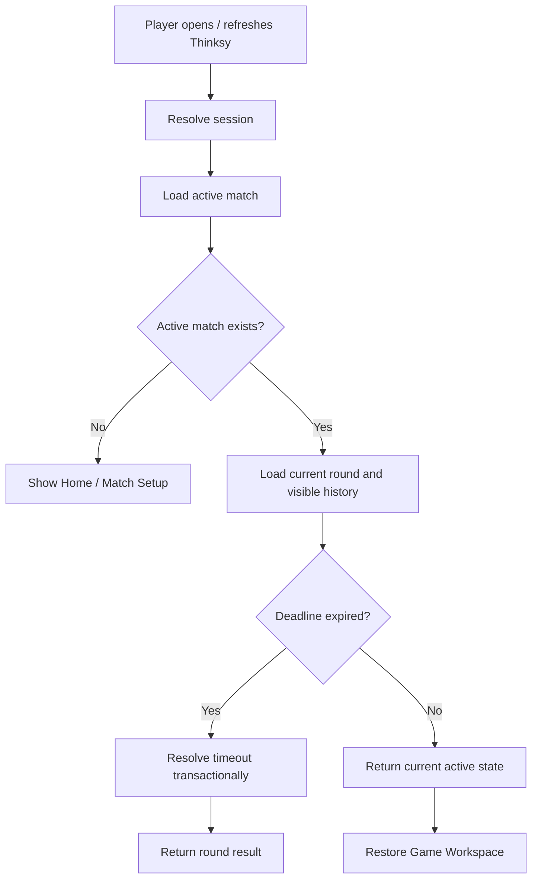

### 11.4 Abandonment and retention

A player leaving the page does not automatically abandon a match. The server preserves the active match until completion, explicit abandonment or expiry under the defined retention policy.

The retention duration is an explicit launch policy. It is communicated in the product wherever it affects guest progress.

---

# 12. Data Strategy & Analytics Architecture

### 12.1 What data Thinksy actually needs

Thinksy collects the information required to understand whether players learn the interaction, conduct meaningful experiments, make predictions and choose to play again.

The product does not need broad personal profiling, invasive behavioural tracking or an external analytics warehouse before there is meaningful usage.

The data strategy has four layers:

1. **Operational data:** identity, matches, rounds, experiments, predictions and rewards.
2. **Product event data:** meaningful player actions and outcomes.
3. **Derived product metrics:** completion, experiment efficiency, difficulty and return play.
4. **Qualitative research:** moderated observations and player explanations.

### 12.2 Data flow

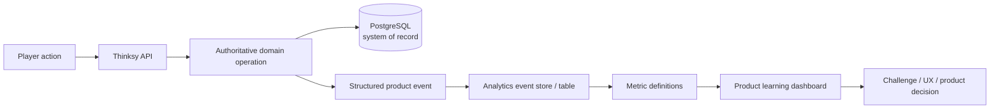

The event is emitted after the authoritative operation succeeds. A rejected or failed operation may generate a diagnostic event, but it must not be counted as a successful experiment.

### 12.3 Core event taxonomy

| Event | Trigger | Important properties | Product question |
|:--|:--|:--|:--|
| `session_started` | Guest/account session begins | session type, platform | Can players enter the game? |
| `how_to_play_opened` | Help opened | entry point | Do players seek instructions? |
| `match_setup_viewed` | Setup screen shown | source screen | Is setup discoverable? |
| `match_started` | Match committed | mode, difficulty | Do players start after setup? |
| `round_started` | Round becomes active | round number, challenge version | Does the match progress correctly? |
| `experiment_submitted` | Valid experiment committed | challenge version, sequence, input type | Are players using the core mechanic? |
| `experiment_rejected` | Input rejected | safe error category | Where does interaction friction occur? |
| `prediction_submitted` | Prediction committed | clue count, round | Do players reach the resolution step? |
| `prediction_evaluated` | Server evaluates prediction | correct, score band | Can players infer the system? |
| `round_timed_out` | Server resolves timeout | mode, difficulty | Is time pressure appropriate? |
| `round_completed` | Round resolves | correctness, score, clues used | Do players complete rounds? |
| `match_completed` | Fifth round resolves | final score, win/loss | Do players complete a match? |
| `match_abandoned` | Match explicitly abandoned or expires | last stage, mode | Where does play stop? |
| `replay_started` | New match after result | previous result | Does the experience invite another play? |
| `profile_viewed` | Profile opened | entry point | Is progression useful? |
| `shop_viewed` | Shop opened | catalogue version | Is the reward layer discoverable? |
| `cosmetic_purchased` | Purchase committed | item ID, price, ledger transaction | Is the economy understandable? |
| `friend_invitation_created` | Invitation created | invite channel | Is social comparison being used? |

Do not emit raw hidden challenge definitions, authentication tokens, full email addresses or unnecessary personal information in analytics.

### 12.4 Metric definitions

| Metric | Definition | Interpretation |
|:--|:--|:--|
| Challenge start rate | Matches started ÷ setup views | Initial appeal and setup clarity |
| First experiment rate | Rounds with at least one accepted experiment ÷ rounds started | Core interaction comprehension |
| Prediction submission rate | Predictions submitted ÷ rounds started | Whether players reach a decision |
| Round completion rate | Rounds resolved ÷ rounds started | Functional and challenge completion |
| Match completion rate | Matches completed ÷ matches started | End-to-end experience completion |
| Prediction accuracy | Correct predictions ÷ evaluated predictions | Challenge inference performance |
| Experiments per correct round | Accepted experiments in correct rounds ÷ correct rounds | Experiment efficiency |
| Timeout rate | Timed rounds expired ÷ timed rounds started | Time pressure and difficulty |
| Abandonment stage | Last recorded stage before abandonment | Friction location |
| Voluntary replay rate | Players starting another match after completion ÷ players completing a match | Immediate repeat-play signal |
| Return rate | Players returning in a defined period ÷ eligible players | Habit/return behaviour |
| Challenge-level solve rate | Correct resolutions for a challenge version ÷ attempts | Challenge calibration |

We do not set arbitrary success thresholds before establishing a baseline. In line with Phase 2, retention and completion targets are set after initial usability and gameplay observations.

### 12.5 Product learning loop

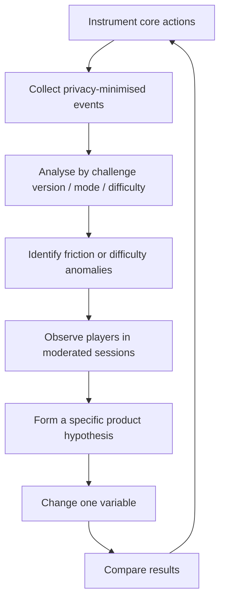

Quantitative metrics show where something happens. Moderated observation helps explain why.

### 12.6 Data governance and classification heat map

Legend: 🟩 low sensitivity · 🟨 controlled · 🟥 restricted.

| Data class | Example | Storage | Access level | Analytics exposure |
|:--|:--|:--|:--|:--|
| Public | Challenge title, public instructions | Public manifest | Public | Allowed |
| Gameplay | Input/output history, score | PostgreSQL | Player + authorised services | Aggregated / pseudonymous |
| Profile | Display name, avatar, streak | PostgreSQL | Player + authorised services | Minimise |
| Identity | Google `sub`, verified email snapshot | Restricted identity tables | Identity service only | Exclude by default |
| Session secret | Raw session cookie/token | Browser cookie only | Never log | Prohibited |
| Private challenge | Hidden rule, accepted answer, internal state | Private challenge storage | Game engine only | Prohibited |
| Economy | Coin ledger, purchase history | PostgreSQL | Player + economy service | Aggregated |
| Security logs | Request ID, abuse signals | Restricted logs | Operations/security | Limited retention |

### 12.7 Data retention policy

This is the data-retention baseline. Exact durations are set against the launch jurisdiction, legal/privacy review and the stated purpose of each data category.

| Data | Retention policy baseline |
|:--|:--|
| Active guest sessions | Retain while active; expire after a defined inactivity window |
| Expired session tokens | Delete or irreversibly invalidate promptly |
| Match and experiment history | Retain while associated with an active account and product purpose |
| Abandoned guest match history | Apply a documented expiry policy |
| Coin ledger | Retain for auditability while the economy is active |
| Operational logs | Short, access-controlled retention |
| Security events | Retain according to incident-response needs |
| Aggregated metrics | Retain longer where no personal identity is present |
| Deleted account data | Delete or anonymise according to documented deletion policy and legal obligations |

Do not set a retention period purely for convenience. Document the purpose and owner of each data category.

### 12.8 Data quality rules

- Use UTC timestamps in storage.
- Keep server-generated timestamps for authoritative events.
- Use stable IDs for player, match, round, challenge and experiment.
- Include `challenge_version_id` in every round.
- Include a request ID in logs and API responses.
- Do not infer correctness from client-side UI state.
- Distinguish accepted experiments from rejected attempts.
- Keep metric definitions version-controlled.
- Record scoring and evaluator versions for historical reproducibility.

---

### 12.9 Data sources and collection

Thinksy's first-party product data is the primary source of truth. External sources are limited to identity verification and operational provider signals.

| Source | Data collected | Collection method | Validation / trust rule | Destination |
|:--|:--|:--|:--|:--|
| Player browser | Submitted input, selected mode/difficulty, explicit actions | Versioned API requests | Treat all client values as untrusted; validate schema, ownership and allowed state | Domain services and PostgreSQL |
| Deterministic game engine | Output, next state, correctness, score and resolution | Server-side execution | Engine version and challenge version recorded; reproducible test required | Match, round, experiment and prediction records |
| Challenge authoring | Public instructions, private rules, accepted answers, test cases and explanation | Reviewed authoring workflow | Schema, engine, solvability, ambiguity and human approval gates | Challenge catalogue and immutable versions |
| Google OIDC | Provider subject and verified identity claims | Server-side authorization-code flow | Validate token signature, issuer, audience, expiry, nonce and state | Restricted identity tables |
| Application runtime | Errors, latency, resource and deployment signals | Structured logs, metrics and traces | Redact secrets and minimise personal data | Restricted operational telemetry |
| Player research | Consent-based observations, interview notes and usability findings | Moderated sessions and research records | Consent, purpose limitation and access control | Restricted research repository; findings summarised for product decisions |

Thinksy does not depend on scraped datasets, third-party behavioural profiles or external training corpora for core gameplay. Challenge content is authored and versioned as product data. The absence of an external data dependency is an explicit architecture decision, not an unexamined omission.

### 12.10 Data pipeline and processing

The product data pipeline is intentionally small and server-controlled:

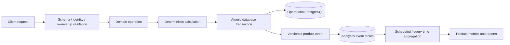

The processing sequence is fixed:

1. Receive the request and assign a request/correlation ID.
2. Authenticate the session and verify resource ownership.
3. Validate payload shape, field bounds, allowed values and current state.
4. Execute the domain operation and deterministic engine transition.
5. Commit the authoritative state, ordered history and corresponding event in one transaction or transactional outbox boundary.
6. Return only the public response DTO.
7. Aggregate privacy-minimised events for product analysis outside the gameplay critical path.

Failed validation does not mutate gameplay state. A rejected request may create a diagnostic record, but it is never counted as an accepted experiment. Analytics failure does not roll back a successfully committed game operation. Event delivery is retryable and idempotent.

### 12.11 Knowledge architecture

Thinksy's knowledge layer is the structured challenge catalogue, not a general-purpose document chatbot. It stores the authored knowledge required to define, execute, explain and validate each challenge.

| Knowledge object | Contents | Relationship |
|:--|:--|:--|
| Challenge metadata | Stable ID, title, category, difficulty, status and tags | Identifies the challenge across versions |
| Public manifest | Player-visible objective, instructions, allowed input shape and constraints | Delivered through public API DTO |
| Private rule definition | Deterministic rule, initial state, accepted answer logic and internal parameters | Accessible only to the engine and authorised authoring tools |
| Engine contract | Engine family, version and typed state/input/output schema | Defines executable compatibility |
| Test corpus | Example inputs, expected outputs, edge cases and invariants | Validates rule behaviour |
| Explanation | Approved reasoning and resolution explanation | Released only when round state permits |
| Version record | Immutable version, author, reviewer, timestamps and content hash | Reproduces historical attempts |

Challenge metadata, public manifests and private rule definitions are separate logical records with explicit access controls. The challenge version binds them together through immutable version identifiers and hashes. Search and filtering use relational metadata and indexed fields. There is no current requirement for embeddings, semantic vector retrieval or a vector database.

### 12.12 Data governance ownership

Every data class has an owner, purpose, access boundary, retention rule and deletion behaviour. Operational gameplay records, restricted identity data, analytics events and qualitative research records remain logically separated. Access is role-based and logged. Data exports are purpose-limited and exclude hidden rules, session secrets and unnecessary identity fields.

The product owner approves new collection purposes. Engineering owns schema enforcement and access controls. Operations owns backup, restoration and incident access. Research owners ensure consent and purpose limitation for moderated sessions.

# 13. AI Research & AI Strategy

### 13.1 The important question

Thinksy is a deterministic reasoning game. The product promise depends on the player being able to infer a consistent system from evidence.

An AI model must therefore not become the authority that decides what the machine does.

A probabilistic language model cannot calculate outputs, update hidden state or evaluate predictions without violating the determinism contract. The same challenge and input could produce different results due to model variation, model updates, prompt changes or inference configuration.

**AI is not required in the authoritative gameplay loop.**

### 13.2 AI capability decision matrix

| Potential AI use | Product value | Risk | Phase 4 decision |
|:--|:--|:--|:--|
| Calculate machine output | Low; deterministic code already does this | Very high integrity risk | **Do not use** |
| Update hidden system state | No advantage over explicit state transitions | Very high | **Do not use** |
| Evaluate prediction | Conflicts with exact challenge rules | Very high | **Do not use** |
| Award points or coins | Must be deterministic and auditable | Very high | **Do not use** |
| Generate challenge ideas | Could accelerate internal ideation | Medium | Optional internal assistant |
| Draft challenge descriptions | Could reduce editorial effort | Medium | Optional; human review |
| Suggest edge cases for tests | Useful as a secondary QA aid | Medium | Optional; deterministic tests remain mandatory |
| Generate candidate challenge data | Could expand content throughput | High validation burden | Defer until validator is proven |
| Personalised hints | Could be useful later | May reveal answer or change fairness | Defer |
| Conversational tutor | Not needed for the core game | Can turn the product into a different experience | Defer |
| Player-facing narrative copy | Limited potential value | Low-to-medium | Optional later, never game-authoritative |

### 13.3 Adopted AI boundary

```mermaid
flowchart TB
    subgraph Internal["INTERNAL CONTENT WORKFLOW — OPTIONAL AI"]
        Author["Human challenge author"]
        Model["AI drafting / idea assistant"]
        Draft["Draft challenge package"]
        Validator["Schema + deterministic validation"]
        Review["Human review and approval"]
        Publish["Immutable challenge version"]
        Author --> Model
        Model --> Draft
        Author --> Draft
        Draft --> Validator
        Validator --> Review
        Review --> Publish
    end

    subgraph Runtime["PLAYER GAMEPLAY — NO LLM DEPENDENCY"]
        Player["Player input"]
        API["Thinksy API"]
        Engine["Deterministic engine"]
        Evaluator["Deterministic evaluator"]
        Player --> API
        API --> Engine
        Engine --> Evaluator
    end

    Publish --> Engine
```

The AI workflow is outside the production runtime. Published challenge definitions are executed by deterministic code.

### 13.4 AI challenge-authoring workflow

If AI is used internally, it may propose:

- A challenge concept.
- Candidate public instructions.
- A candidate rule description.
- Candidate test cases.
- Potential edge cases.
- A draft explanation.

It may not publish a challenge or decide that a challenge is valid.

Every AI-assisted draft must pass:

1. Schema validation.
2. Engine compatibility validation.
3. Deterministic execution tests.
4. Exhaustive or bounded input-space checks where practical.
5. Solvability and accepted-answer checks.
6. Ambiguity review.
7. Explanation-to-engine consistency checks.
8. Human approval.

### 13.5 AI governance

| Control | Requirement |
|:--|:--|
| Human ownership | A named human author/reviewer owns each published challenge |
| Provenance | Record whether AI assisted in drafting |
| Validation | No model output bypasses deterministic validation |
| Privacy | Do not send player identity or private match data to external models |
| Secrets | Never include hidden live challenge definitions in unapproved third-party prompts |
| Model changes | Revalidate the workflow when model/provider behaviour changes |
| Auditability | Keep approved source definition and version hash |
| Fallback | Core game works with all AI services unavailable |

### 13.6 What Thinksy does not need now

Do not build the following for the first production release:

- LLM calls in the game loop.
- Retrieval-augmented generation (RAG).
- A vector database.
- Fine-tuned models.
- Multi-agent orchestration.
- GPU inference infrastructure.
- Real-time AI hints.
- AI-based scoring or player assessment.

These components add cost and operational complexity without solving the current product's central technical problem.

### 13.7 AI research conclusion

AI is restricted to optional internal content and QA assistance, and only operates against the established challenge specification and deterministic validator. It is not a prerequisite for Thinksy and never replaces the game engine, evaluator, scoring policy or reward ledger.

---

### 13.8 AI technology landscape and applicability

The Phase 4 AI research covers the technologies in the product lifecycle definition. Each is assessed against an actual Thinksy use case rather than adopted because it is available.

| Technology | What it does | Thinksy use case assessed | Phase 4 decision |
|:--|:--|:--|:--|
| Large language models (LLMs) | Generate and transform language from prompts and context | Internal challenge ideation, draft instructions and QA suggestions | Optional internal assistance only; no gameplay authority |
| Machine learning | Learns patterns from data for prediction or classification | Difficulty calibration, player behaviour prediction or anomaly detection | No validated dataset or decision need; not selected |
| Deep learning | Neural-network methods for complex learned representations | No current perception, speech or large-scale prediction requirement | Not selected |
| Generative AI | Generates text, code, images or structured candidate content | Draft challenge copy, explanations and test ideas | Optional internal drafting with deterministic validation and human approval |
| Embeddings | Map content into vector representations for semantic similarity | Semantic search across a large challenge or research library | No demonstrated corpus/search problem; not selected |
| Vector databases | Store and retrieve embedding vectors | Retrieval across a large semantic content corpus | No current requirement; PostgreSQL metadata search is sufficient |
| Retrieval-augmented generation (RAG) | Grounds model responses in retrieved source material | Internal assistant over challenge-authoring standards or technical references | Not required for the current content scale; no RAG pipeline selected |
| Fine-tuning | Adapts model behaviour using training examples | Consistent challenge authoring voice or structured output | Not justified without a stable dataset and measured baseline |
| Model orchestration | Routes prompts, tools, retries and model calls | A controlled internal authoring workflow | A simple single-provider adapter is sufficient if introduced; no orchestration platform selected |
| AI agents | Models that plan and use tools to complete tasks | Internal QA or authoring assistant | No autonomous agent required; human-owned workflow retained |
| Multi-agent systems | Multiple agents coordinate specialised tasks | Parallel challenge creation/review | Adds coordination and verification overhead without a validated need; excluded |
| Inference architecture | Runtime path for executing model requests | Internal AI assistance | No production inference path required; any future use is asynchronous and isolated |
| Model serving | Hosting and scaling model inference | Self-hosted model endpoint | No model-serving infrastructure selected; external managed inference is evaluated only if a real use case appears |

The deterministic game engine is not an AI system. It is explicit application logic with versioned rules and reproducible state transitions. No ML or generative model is allowed to replace that engine.

### 13.9 Model selection and benchmarking decision

No AI model is selected for the production gameplay system. No model benchmark is claimed as completed because Phase 4 identifies no approved runtime AI use case that warrants a model. Model benchmarking is therefore specified as a repeatable future approval method, not misrepresented as a completed experiment.

For any future internal AI workflow, model selection is evidence-led and compares at least:

| Evaluation dimension | Measurement |
|:--|:--|
| Task quality | Human-rated usefulness, correctness and completeness against a fixed task set |
| Structured-output reliability | Schema-valid response rate and repair rate |
| Groundedness | Unsupported claim rate against supplied source material |
| Instruction adherence | Constraint and format compliance |
| Safety | Sensitive-data leakage, prompt-injection resistance and unsafe output rate |
| Latency | p50 and p95 response time for the defined workload |
| Cost | Cost per accepted output, including retries and human review |
| Operational fit | Provider availability, data handling, retention, region and contractual terms |
| Portability | Ability to change model/provider without changing domain contracts |

The benchmark dataset is versioned and contains representative challenge-authoring and QA tasks, expected outputs or scoring rubrics, edge cases and adversarial prompts. Candidate models are evaluated on the same dataset and configuration. Human review is included for quality-sensitive outputs. Model version, prompt version, parameters, test date and result are recorded. A model is not approved solely because it produces fluent text.

### 13.10 AI inference, orchestration and serving boundary

Any approved internal AI capability runs asynchronously behind an internal adapter. The adapter owns provider authentication, request schema, timeout, retry limits, token budgets, logging redaction, model/version pinning and fallback behaviour. The authoring workflow stores generated output as an untrusted draft. A deterministic validator and human reviewer remain the publication authority.

No AI call is made in the experiment, prediction, scoring, timeout, reward or match-resolution request path. No model endpoint receives hidden live challenge data or identifiable player data unless a separately approved privacy and security assessment explicitly permits it. Core gameplay remains fully available when every AI provider is unavailable.

### 13.11 AI research conclusion

The complete AI landscape has been assessed. The Phase 4 decision is not to add AI infrastructure without a validated use case. LLMs and generative AI remain optional internal drafting aids; ML, deep learning, embeddings, vector search, RAG, fine-tuning, agent systems, multi-agent orchestration, inference infrastructure and model serving are not selected for the current product. Model selection and benchmarking are governed by the protocol above and begin only when an approved use case exists.

# 14. Security Architecture & Threat Model

### 14.1 Security objectives

1. Protect player identity and sessions.
2. Prevent access to another player's matches.
3. Keep hidden rules and answers private until resolution.
4. Prevent client-side manipulation of score, time, clues and rewards.
5. Prevent duplicate experiment and purchase execution.
6. Bound resource consumption.
7. Preserve an auditable record of important state changes.
8. Minimise personal data collection.

### 14.2 Threat surface map

| Threat | Likelihood | Impact | Heat | Primary control |
|:--|:--:|:--:|:--:|:--|
| Hidden answer extracted from API | Medium | Critical | 🟥 | Public/private DTO separation |
| Match ID manipulation / BOLA | Medium | High | 🟥 | Object-level ownership checks on every operation |
| Client alters score or clues | High | High | 🟥 | Server-authoritative calculation |
| Duplicate experiment on retry | Medium | Medium | 🟨 | Idempotency key + unique constraint |
| Concurrent experiment requests | Medium | High | 🟥 | Transaction + row lock/version |
| Forged Google identity | Medium | Critical | 🟥 | OIDC token verification |
| Session theft | Medium | High | 🟥 | Secure cookies, TLS, rotation, revocation |
| CSRF against session operations | Medium | High | 🟥 | SameSite, CSRF token/origin checks |
| Brute-force / automated submissions | Medium | Medium | 🟨 | Rate limits and resource bounds |
| Coin farming / purchase replay | Medium | High | 🟥 | Ledger, idempotency and server rules |
| SQL injection | Low with controls | Critical | 🟨 | Parameterised SQL and least privilege |
| Challenge script execution | Low if excluded | Critical | 🟨 | No arbitrary `eval` or user code |
| Sensitive data in logs | Medium | High | 🟥 | Redaction and structured logging policy |

Risk levels are qualitative design assessments, not measured incident probabilities.

### 14.3 Threat-control map

```mermaid
flowchart TD
    A["Untrusted browser request"] --> B["TLS + request size limits"]
    B --> C["Session verification"]
    C --> D["Object-level authorization"]
    D --> E["Schema and domain validation"]
    E --> F["Rate / resource limits"]
    F --> G["Transaction + idempotency"]
    G --> H["Deterministic domain operation"]
    H --> I["Explicit player-safe response"]
    I --> J["Audit / operational event"]
```

### 14.4 Authentication and authorisation

- Verify every identity on the server.
- Never trust a client-submitted `playerId`.
- Check ownership for every match, round, profile, invitation and inventory operation.
- Do not rely on unguessable IDs as authorisation.
- Separate user and administrative capabilities.
- Use least-privilege database credentials.
- Add tests that attempt to access another player's object.

OWASP identifies broken object-level authorisation as a major API risk. Every endpoint that uses a client-supplied object ID must verify that the caller is allowed to access that object.

Reference: [OWASP API1:2023 — Broken Object Level Authorization](https://api-security.owasp.org/editions/2023/en/0xa1-broken-object-level-authorization/).

### 14.5 Input validation

Validate on the server:

- Content type and payload size.
- Input type and structure.
- Numeric bounds and candidate membership.
- Clue budget and duplicate-input policy.
- Round and match status.
- Expected sequence.
- Idempotency key format.
- Prediction format.
- Cosmetic item availability and price.
- Friend invitation status.

Client-side validation improves usability. It is not a security control.

### 14.6 Hidden-rule protection

Never expose private challenge fields through:

- JavaScript bundles.
- Static JSON files.
- Browser storage.
- HTML attributes.
- Public API responses.
- Debug routes.
- Error messages.
- Analytics events.

The engine reads private definitions from the server-side repository. The API constructs a separate response containing only the information the player is permitted to see.

### 14.7 Economy integrity

The coin balance is a derived value from an immutable transaction ledger.

Do not update a balance based on a client-submitted amount. The server calculates the reward or purchase cost from versioned configuration and records a ledger transaction.

For every purchase:

1. Verify player session and ownership.
2. Verify item exists and is purchasable.
3. Verify item is not already owned, if ownership is unique.
4. Verify sufficient balance.
5. Verify idempotency key.
6. Insert debit transaction.
7. Insert inventory record.
8. Commit atomically.

A failed purchase must not deduct coins. A retry must not create a second debit.

### 14.8 Security references

- [OWASP API Security Top 10](https://owasp.org/www-project-api-security/)
- [OWASP REST Security Cheat Sheet](https://cheatsheetseries.owasp.org/cheatsheets/REST_Security_Cheat_Sheet.html)
- [OWASP Input Validation Cheat Sheet](https://cheatsheetseries.owasp.org/cheatsheets/Input_Validation_Cheat_Sheet.html)
- [OWASP Authorization Cheat Sheet](https://cheatsheetseries.owasp.org/cheatsheets/Authorization_Cheat_Sheet.html)
- [IETF OAuth 2.0 Security Best Current Practice — RFC 9700](https://www.rfc-editor.org/rfc/rfc9700.html)

---

# 15. Social, Profile & Virtual Economy Architecture

Phase 3 includes profile, streak, rewards, shop, friend-code and leaderboard experiences. Phase 2 deliberately cautions against allowing social or monetisation features to substitute for a compelling core game.

The architecture supports the documented presentation while keeping these capabilities staged behind the core gameplay quality gates.

### 15.1 Profile and progress

Profile statistics are derived from completed match and round records wherever practical.

Examples:

- Matches played and completed.
- Win/loss count.
- Correct rounds.
- Total score.
- Personal best.
- Current and longest streak.
- Coins earned and spent.
- Achievement unlocks.

Avoid treating a client-submitted profile statistic as authoritative.

### 15.2 Streaks

A streak is derived from qualifying activity on distinct calendar days under a defined timezone policy.

The policy must specify:

- Which player action qualifies.
- Which timezone defines a day.
- How missed days affect the streak.
- How the longest streak is calculated.
- Whether a guest streak transfers to a linked account.

The interface displays streak progress only when the underlying streak rule is enforced by the authoritative service.

### 15.3 Friend-code lifecycle

```mermaid
stateDiagram-v2
    [*] --> NoInvitation
    NoInvitation --> Pending: Create invitation
    Pending --> Accepted: Recipient accepts
    Pending --> Declined: Recipient declines
    Pending --> Expired: Invitation expires
    Accepted --> Removed: Either player removes friendship
    Declined --> [*]
    Expired --> [*]
    Removed --> [*]
```

A friend code is an invitation mechanism, not proof that a relationship already exists.

Friendship rules must prevent duplicate relationships, self-invites and unauthorised acceptance. The current friend-add route is a prototype affordance and does not establish durable relationships.

### 15.4 Leaderboard architecture

The leaderboard is a read model, not the source of truth for scores.

- Source records: completed matches and server-calculated scores.
- Ranking policy: explicitly defined and versioned.
- Tie handling: deterministic.
- Scope: friends and/or global, only when the relevant dataset exists.
- Update cadence: defined and communicated.
- Player visibility: do not imply a live global ranking if the data is configured or partial.

No real-time multiplayer, matchmaking, leagues or tournaments are part of this architecture.

### 15.5 Coin ledger

Use an immutable ledger:

| Field | Purpose |
|:--|:--|
| `id` | Transaction ID |
| `player_id` | Account owner |
| `transaction_type` | Earn, spend, refund, adjustment |
| `amount_delta` | Positive or negative amount |
| `reason_code` | Match participation, victory, purchase, etc. |
| `reference_type` | Match, purchase or admin action |
| `reference_id` | Related record |
| `idempotency_key` | Duplicate protection |
| `created_at` | Server timestamp |

The balance is:

\[
\text{Coin Balance} = \sum \text{Ledger Amount Delta}
\]

A cached balance is permitted as a performance read model; the immutable ledger remains the audit source.

### 15.6 Reward policy

The reward contract returns a server-calculated breakdown for display. Numeric reward constants are centralised in a versioned reward policy and must match the canonical source implementation before release.

Do not recreate reward amounts from UI copy or duplicate constants in the frontend.

---

# 16. Infrastructure, Deployment & Environments

### 16.1 Environments

| Environment | Purpose | Data policy |
|:--|:--|:--|
| Local | Developer workflow | Synthetic/local data |
| CI | Automated tests | Ephemeral seeded data |
| Staging | Production-like verification | Synthetic or anonymised data |
| Production | Real players | Protected personal and gameplay data |

Production credentials must never be copied into local or test environments.

### 16.2 Deployment pipeline

```mermaid
flowchart LR
    A["Commit / Pull Request"] --> B["Static checks + type checks"]
    B --> C["Unit tests"]
    C --> D["Integration tests"]
    D --> E["Build artifact"]
    E --> F["Migration compatibility check"]
    F --> G["Deploy staging"]
    G --> H["Smoke / regression tests"]
    H --> I{"Release approved?"}
    I -->|No| J["Fix / rollback"]
    I -->|Yes| K["Deploy production"]
    K --> L["Health checks + monitoring"]
```

### 16.3 Migration policy

- All schema changes are version-controlled.
- Migrations are applied in a controlled deployment step.
- Destructive migrations require a backup and rollback/forward-fix plan.
- Prefer additive migrations followed by code migration and later cleanup.
- Test migrations against a copy of representative data.
- Never manually edit production schema without recording the change.

### 16.4 Configuration and secrets

Use environment-specific configuration or a managed secret store for:

- Database connection URL.
- Google OAuth client ID and secret where applicable.
- Session signing/hash secrets.
- Application environment.
- Allowed origins.
- Logging and monitoring keys.
- Backup configuration.

Do not commit secrets to Git or include them in frontend build variables.

### 16.5 Backups and recovery

The production recovery objectives are:

| Measure | Acceptance target | Status |
|:--|:--|:--|
| Recovery Point Objective (RPO) | 15 minutes or less | Acceptance objective; provider capability verification required |
| Recovery Time Objective (RTO) | 4 hours or less | Acceptance objective; recovery drill required |
| Backup frequency | Managed automated backups; point-in-time recovery where available | Provider-dependent |
| Restore test | Before production launch and on a recurring schedule | Required |
| Migration rollback | Documented forward-fix/rollback plan | Required |

These are the engineering acceptance thresholds. They are not represented as achieved service measurements until operational evidence confirms them.

---

### 16.6 Infrastructure and operating-cost estimation

The cost model is based on the adopted modular monolith and managed PostgreSQL architecture. It does not assume a provider, region, traffic volume or current negotiated price that has not been selected and verified.

| Cost component | Primary cost driver | Estimation basis | Cost control |
|:--|:--|:--|:--|
| Application hosting | Instance size, instance count, uptime and outbound traffic | Monthly runtime hours × selected instance rate, plus bandwidth | Start with one appropriately sized instance; scale from measured CPU, memory and latency |
| PostgreSQL | Compute tier, storage, IOPS, backups and high availability | Database tier + allocated storage + backup/HA charges | Right-size after load tests; monitor query plans and storage growth |
| Network / CDN | Egress, request volume and static asset delivery | Monthly GB transferred and request count | Compress assets, cache public static files and avoid large API payloads |
| Monitoring | Log ingestion, retention, metrics and trace volume | Ingested GB/events and retention period | Sample routine traces; redact and avoid duplicate high-cardinality events |
| Email (if enabled) | Message volume and provider tier | Monthly messages and delivery tier | Transactional-only use; no assumed bulk marketing |
| Google OIDC | Identity-provider terms and usage limits | Provider terms and applicable quota | No cost assumption until current provider terms are checked |
| AI assistance (optional) | Model, tokens, retries and accepted outputs | Input/output tokens × provider rate + review cost | No AI runtime budget in core gameplay; impose per-task budgets if approved |
| Backup / recovery | Retention, point-in-time recovery and restore operations | Database plan and retained backup volume | Define retention by recovery objective and test restores |

The monthly operating estimate is calculated as:

\[
C_{\text{monthly}} =
C_{\text{app}} + C_{\text{database}} + C_{\text{network}} +
C_{\text{observability}} + C_{\text{integrations}} +
C_{\text{backup}} + C_{\text{optional AI}}
\]

The operating model records three scenarios—baseline launch, expected growth and peak load—with the assumptions for active players, concurrent sessions, experiments per session, database growth, event volume, retention and egress. Each scenario is priced against the selected provider's current public or contracted rates before deployment approval.

**Cost decision:** Thinksy does not carry a Kubernetes, microservices, GPU inference, vector database or always-on AI serving cost in the initial release. Provider-specific monthly amounts remain unquoted until region, instance tier, database tier, traffic assumptions and current rates are verified. The cost estimate is refreshed when measured usage materially changes the workload.

# 17. Observability & Operational Intelligence

### 17.1 What must be observable

The system provides the signals required to answer:

- Did a match start?
- Did an experiment reach the engine?
- Did the engine return an output?
- Did the database commit the state change?
- Did the client receive the response?
- Did a round resolve before or after its deadline?
- Did a reward transaction commit exactly once?
- Which challenge version caused an error?
- Which application release introduced a regression?

### 17.2 Three operational signals

| Signal | What it captures | Thinksy example |
|:--|:--|:--|
| Logs | Discrete diagnostic records | Experiment rejected because sequence was stale |
| Metrics | Aggregated system behaviour | Experiment API p95 latency |
| Traces | Request path across modules | Browser request → API → engine → PostgreSQL |

OpenTelemetry's JavaScript documentation supports traces and metrics as stable signals; its JavaScript logs status is still developing in the documentation. Use structured application logs regardless, and adopt the stable instrumentation components that fit the deployment.

Reference: [OpenTelemetry JavaScript](https://opentelemetry.io/docs/languages/js/).

### 17.3 Required operational metrics

- API request count and error rate.
- p50 / p95 / p99 latency by route.
- Experiment execution duration.
- Database connection utilisation.
- Database query latency.
- Transaction rollback count.
- Idempotency replay count.
- Sequence conflict count.
- Timeout resolution count.
- Authentication failure count.
- Rate-limit count.
- Purchase failure and duplicate-attempt count.
- Application memory and CPU.
- Backup and restore status.

### 17.4 Alerting priorities

| Priority | Example | Response |
|:--|:--|:--|
| P0 | Data corruption, hidden-answer exposure, widespread auth bypass | Stop rollout / incident response |
| P1 | Match state cannot be persisted, widespread 5xx | Immediate engineering response |
| P2 | Elevated experiment latency or isolated feature failure | Investigate during operating window |
| P3 | Non-critical UI or analytics issue | Queue for normal prioritisation |

---

# 18. Performance, Reliability & Scalability

### 18.1 Performance priorities

The critical path is experiment submission. It is computationally bounded and uses a small number of database operations.

Avoid:

- Loading the entire challenge catalogue for every request.
- Sending private challenge data to the browser.
- Running expensive challenge generation inside a player request.
- Performing unrelated analytics work synchronously.
- Keeping authoritative state in process memory.
- Adding a cache before measuring a real bottleneck.

### 18.2 Service-Level Acceptance Targets

These are the approved engineering acceptance thresholds. They become achieved service levels only after measurement.

| Measure | Acceptance target | Measurement |
|:--|:--|:--|
| Standard API response | p95 ≤ 300 ms | Route-level metrics |
| Experiment submission | p95 ≤ 500 ms under agreed test load | End-to-end request trace |
| Prediction resolution | p95 ≤ 500 ms under agreed test load | End-to-end request trace |
| Availability | 99.5% monthly acceptance threshold | Uptime monitoring |
| Database transaction | No partial experiment state | Integration and fault-injection tests |
| Duplicate request | No duplicate state mutation | Idempotency tests |
| Recovery | RPO ≤ 15 min / RTO ≤ 4 hr | Restore drill |

Load testing uses a realistic workload derived from the launch cohort. A target is recorded as achieved only when the test report provides measured evidence.

### 18.3 Scaling path

```mermaid
flowchart LR
    A["Stage 1<br/>One app + PostgreSQL"] --> B["Stage 2<br/>Tune queries + indexes"]
    B --> C["Stage 3<br/>Scale app instances"]
    C --> D["Stage 4<br/>Add cache only if measured"]
    D --> E["Stage 5<br/>Extract a workload only if justified"]
```

#### Stage 1 — Initial release

One application deployment and one managed PostgreSQL database.

#### Stage 2 — Query optimisation

Use query plans, indexes, pagination and connection pooling before introducing additional infrastructure.

#### Stage 3 — Horizontal application scaling

Add application instances once traffic or availability requires it. All authoritative state remains in PostgreSQL.

#### Stage 4 — Conditional caching

Redis is not part of the initial architecture. It is considered only if measured demand establishes a need for rate limits, ephemeral shared coordination or cacheable read models; PostgreSQL remains the system of record.

#### Stage 5 — Service extraction

Extract a module only when independent scaling, security isolation, team ownership or operational constraints make it necessary. The game engine is a candidate only if a later workload profile justifies a separate execution boundary.

---

# 19. Architecture Risks & Mitigation Heat Map

Legend: 🟥 high priority · 🟨 medium priority · 🟩 controlled / lower priority.

| Risk | Probability | Impact | Priority | Mitigation |
|:--|:--:|:--:|:--:|:--|
| Hidden challenge rule leaks | Medium | Critical | 🟥 | Public/private separation, API contract tests |
| State lost on process restart | High in current prototype | High | 🟥 | PostgreSQL persistence before production |
| Duplicate experiment due to retry | Medium | High | 🟥 | Idempotency + unique constraint |
| Concurrent experiments corrupt sequence | Medium | High | 🟥 | Transaction lock/version control |
| Google profile spoofing | High in current prototype | Critical | 🟥 | Verified OIDC |
| Reward duplication or coin farming | Medium | High | 🟥 | Ledger, idempotency, audit |
| Challenge is ambiguous | Medium | High | 🟥 | Solvability and uniqueness validation |
| Stateful engine becomes hard to debug | Medium | High | 🟨 | Replay, snapshots and explicit state |
| Overbuilding infrastructure | Medium | Medium | 🟨 | Modular monolith and ADR discipline |
| Difficulty is poorly calibrated | Unknown | Medium | 🟨 | Moderated playtests and event analysis |
| Players do not return | Unknown | High product risk | 🟨 | Product validation; not solved by infrastructure |
| Analytics collects excess data | Medium | Medium | 🟨 | Data minimisation and retention policy |
| Framework rewrite delays launch | Medium | Medium | 🟨 | Retain existing frontend |
| AI-generated challenge is invalid | Medium | High | 🟨 | Deterministic validator + human approval |

### 19.1 Product risk versus engineering risk

The architecture can reduce engineering risk. It cannot prove that players enjoy Thinksy.

| Risk category | What Phase 4 can solve | What requires later evidence |
|:--|:--|:--|
| Deterministic correctness | Engine contract and replay tests | Production regression data |
| Persistence | Database architecture | Operational recovery test |
| Authentication | OIDC design | Real provider integration and security test |
| Challenge validity | Validation pipeline | Actual player comprehension |
| Difficulty | Instrumentation and versioning | Moderated gameplay and calibration |
| Replayability | Event model and progression support | Return-play behaviour |
| Market demand | Nothing directly | User research and commercial validation |

---

# 20. Architecture Decision Records (ADRs)

The following decisions form the approved Phase 4 baseline. Any material deviation in Phase 5 is recorded with its rationale, consequences and implementation impact.

| ADR | Decision | Status | Rationale |
|:--|:--|:--:|:--|
| ADR-001 | Modular monolith for initial production | Accepted | Smallest architecture that preserves clear boundaries |
| ADR-002 | Retain existing browser UI initially | Accepted | Avoid unnecessary rewrite |
| ADR-003 | Node.js LTS runtime | Accepted | Aligns with current codebase |
| ADR-004 | Gradual TypeScript adoption | Accepted | Stronger engine and API contracts |
| ADR-005 | PostgreSQL as system of record | Accepted | Relational integrity and transactions |
| ADR-006 | Server-authoritative deterministic engine | Accepted | Fairness and reproducibility |
| ADR-007 | Structured immutable challenge versions | Accepted | Historical correctness |
| ADR-008 | Public/private challenge separation | Accepted | Hidden-rule protection |
| ADR-009 | Ordered experiment log + state snapshots | Accepted | Replay without full event sourcing |
| ADR-010 | Guest-first with optional verified Google OIDC | Accepted | Low-friction entry and persistent identity |
| ADR-011 | Server-managed opaque sessions | Accepted | Revocation and secure session control |
| ADR-012 | Idempotent experiment and purchase operations | Accepted | Retry and concurrency safety |
| ADR-013 | PostgreSQL transaction ledger for coins | Accepted | Auditable economy |
| ADR-014 | Minimal server-side analytics taxonomy | Accepted | Product learning with data minimisation |
| ADR-015 | No AI in authoritative gameplay | Accepted | Deterministic game contract |
| ADR-016 | Managed app + managed PostgreSQL deployment | Accepted | Operational simplicity |
| ADR-017 | No Redis until measured need | Accepted | Avoid premature infrastructure |
| ADR-018 | No microservices / Kubernetes for first release | Accepted | No current product requirement |

### 20.1 Decisions deliberately left to implementation verification

These decisions are settled at the architecture level. Phase 5 verifies the implementation details against the approved contracts:

- Exact supported Node.js LTS patch version.
- Exact package and dependency versions.
- PostgreSQL major version supported by the selected host.
- SQL migration runner and repository implementation.
- Exact hosting provider and region.
- Google OAuth client configuration and redirect URIs.
- Monitoring/error-reporting provider.
- Backup and point-in-time recovery capability.
- Guest-session expiry duration.
- Data retention durations.
- Exact API payload field names and OpenAPI file.
- Final challenge schema and engine type inventory based on the real authored challenge set.

---

# 21. Phase 5 — Engineering & Product Implementation Handoff

Phase 5 implements this established architecture while preserving the approved Phase 3 experience and the agreed product scope.

### 21.1 Implementation sequence

```mermaid
flowchart TD
    A["1. Repository and runtime baseline"] --> B["2. Domain types and module boundaries"]
    B --> C["3. Challenge schema and registry"]
    C --> D["4. Deterministic engine extraction"]
    D --> E["5. Engine tests and replay harness"]
    E --> F["6. PostgreSQL schema and migrations"]
    F --> G["7. Match / round persistence"]
    G --> H["8. Experiment and prediction APIs"]
    H --> I["9. Guest identity and verified OIDC"]
    I --> J["10. Profile / progress / economy integrity"]
    J --> K["11. Analytics and observability"]
    K --> L["12. Deployment and production verification"]
```

### 21.2 Workstream plan

| Workstream | Engineering output | Dependency | Acceptance evidence |
|:--|:--|:--|:--|
| Foundation | Runtime, config, module layout, CI | None | Reproducible local and CI build |
| Domain model | Typed match, round, challenge and experiment types | Foundation | Type checks and domain tests |
| Challenge system | Versioned schema, registry and validator | Domain model | Invalid challenge cannot publish |
| Engine | Pure deterministic transition modules | Challenge system | Replay and determinism tests |
| Persistence | PostgreSQL schema and migrations | Domain model | Integration tests and constraints |
| Match service | Durable match and round lifecycle | Persistence | Refresh/restart recovery test |
| Experiment API | Atomic, idempotent experiment execution | Engine + persistence | Duplicate/concurrency tests |
| Prediction API | Server-side evaluation and scoring | Challenge system | Correct/incorrect/timeout tests |
| Identity | Guest sessions and verified Google OIDC | Persistence | Token verification and session tests |
| Progress/economy | Stats, streaks, ledger and inventory | Identity + match | Atomic reward and purchase tests |
| Social | Durable invitations/friendships; leaderboard read model | Identity | Relationship and access-control tests |
| Analytics | Server-side event taxonomy | Domain operations | Event schema and privacy tests |
| Operations | Hosting, logs, metrics, backups and recovery | All critical modules | Staging and restore evidence |
| UX preservation | Connect existing UI to stable API | API contracts | Existing flow regression tests |

### 21.3 Phase 5 engineering rules

1. Preserve the existing visual identity and approved interaction model.
2. Do not put hidden challenge rules into frontend code.
3. Do not move authoritative state back into browser memory.
4. Do not change scoring or reward values without an approved product decision.
5. Do not introduce arbitrary challenge JavaScript or `eval`.
6. Do not make AI a runtime dependency.
7. Do not add multiplayer or tournament systems.
8. Do not add Redis or microservices without a measured need and an ADR.
9. Do not remove current automated tests while refactoring; replace only when equivalent or stronger coverage exists.
10. Keep all production-only credentials out of the repository.

---

# 22. Phase 4 Completion & Architecture Acceptance

Phase 4 is complete when the technical direction is sufficiently defined for Phase 5 to implement without inventing foundational architecture.

| Area | Phase 4 outcome |
|:--|:--|
| Product context | Aligned to Phase 1–3 |
| Technical feasibility | Existing prototype and production gaps assessed |
| Technology stack | Selected |
| Application architecture | Modular monolith adopted |
| Frontend direction | Existing vanilla frontend retained initially |
| Runtime/language | Node.js LTS + gradual TypeScript |
| Database | PostgreSQL adopted |
| Engine architecture | Deterministic server-side module defined |
| Challenge architecture | Public/private definitions and immutable versions defined |
| Match lifecycle | Match/round state and timeout rules defined |
| Experiment execution | Atomic, ordered and idempotent |
| Prediction | Separate server-authoritative evaluator |
| Identity | Guest-first and verified Google OIDC |
| Session architecture | Server-managed opaque sessions |
| Data model | Core entities and relationships defined |
| Data strategy | Event taxonomy and metric definitions established |
| AI strategy | Explicitly excluded from authoritative gameplay |
| Security | Threat model and controls defined |
| Economy | Immutable transaction ledger architecture defined |
| Social | Durable relationship model defined |
| Infrastructure | Managed app + PostgreSQL model defined |
| Observability | Logs, metrics and traces defined |
| Reliability | Service-level acceptance targets and recovery requirements defined |
| Scaling | Evidence-led progression defined |
| Phase 5 handoff | Workstreams and acceptance criteria defined |

### 22.1 What is not claimed as complete

The following are Phase 5 implementation and verification responsibilities:

- PostgreSQL has not been proven live by the prototype review.
- Google OIDC has not been proven live by the prototype review.
- Durable match recovery has not been proven live by the prototype review.
- Production friend relationships and leaderboard integrity have not been proven live.
- Production coin-ledger integrity has not been proven live.
- Production observability and backup restoration have not been proven live.
- Performance targets have not been measured.
- Moderated usability and player enjoyment remain unvalidated.

This distinction is deliberate. A completed architecture is not the same as a deployed production system.

---

# 23. Final Phase 4 Decision

Thinksy enters Phase 5 with an established, proportionate technical foundation.

The adopted architecture is a **Node.js modular monolith with progressive TypeScript adoption, the existing browser UI retained initially, PostgreSQL as the system of record, and an isolated deterministic server-side game engine**.

Challenges use structured, validated and versioned definitions. Each round references an immutable challenge version. Accepted experiments are stored in order and committed atomically with the next authoritative state. The server calculates every prediction, score, timeout and reward.

The product uses a guest-first identity model and verified Google OpenID Connect for players who choose persistent accounts. Sessions are server-managed. Profile, friend, leaderboard and cosmetic-economy features use durable relational data and explicit integrity controls; their rollout remains subordinate to proving the core game.

AI remains outside authoritative gameplay. Internal challenge ideation and QA drafting are permitted only within a deterministic validation and human-approval process.

The first production release does not require microservices, Kubernetes, Redis, a vector database, RAG, fine-tuning or a model-serving stack. Those technologies do not solve a current Thinksy requirement.

**Phase 4 outcome:** We have completed the technical research, AI strategy, data strategy and system architecture. The architecture, technology decisions, domain boundaries, data model, API contracts, security controls, operating requirements and Phase 5 acceptance criteria are established. Phase 5 owns production implementation and evidence-based verification; this document does not misrepresent architecture decisions as deployed infrastructure.

> **The architecture protects the experience; it does not become the experience.**

---

# 24. Phase 5 Definition of Done

Phase 5 completion is accepted only when the following evidence exists.

### 24.1 Gameplay integrity

- [ ] The same challenge version and ordered inputs reproduce the same outputs.
- [ ] Hidden rules are absent from player-facing responses before resolution.
- [ ] Invalid inputs do not mutate state.
- [ ] Duplicate requests do not duplicate experiments.
- [ ] Concurrent requests cannot corrupt experiment order.
- [ ] Server deadlines determine timed-round expiry.
- [ ] Prediction and score are calculated on the server.
- [ ] Match completion and win/loss rules match the approved product configuration.

### 24.2 Persistence and identity

- [ ] PostgreSQL migrations run in CI and staging.
- [ ] Match state survives browser refresh.
- [ ] Match state survives application restart.
- [ ] Guest sessions work without mandatory sign-in.
- [ ] Google ID tokens are verified server-side.
- [ ] Account linking follows an explicit merge policy.
- [ ] Ownership checks are tested on all player-owned resources.

### 24.3 Economy and social

- [ ] Coin awards are recorded in a ledger.
- [ ] Purchases are atomic and idempotent.
- [ ] Client cannot set or modify coin balance.
- [ ] Inventory cannot duplicate unique-owned items.
- [ ] Friend invitations have durable lifecycle states.
- [ ] Leaderboard source and ranking policy are documented.

### 24.4 Operations and quality

- [ ] Production secrets are managed outside source control.
- [ ] HTTPS is enforced.
- [ ] Structured logs contain request IDs and redact secrets.
- [ ] Error and latency metrics are available.
- [ ] Backup restoration is tested.
- [ ] Rollback or forward-fix procedure is documented.
- [ ] Accessibility checks cover keyboard, focus, contrast and reduced motion.
- [ ] Responsive checks cover narrow mobile through wide desktop.
- [ ] Moderated gameplay sessions are conducted.
- [ ] Load tests report measured performance against the approved service-level acceptance targets.

---

# 25. Glossary

| Term | Meaning in Thinksy |
|:--|:--|
| Deterministic | Same initial conditions and ordered inputs produce the same result |
| Challenge | A defined hidden system the player investigates |
| Challenge version | Immutable version of the challenge's public and private definitions |
| Public manifest | Player-visible challenge information |
| Private definition | Server-only rules, state and evaluation configuration |
| Engine | Code that executes a challenge's deterministic transition |
| Attempt / round | A player's run through one challenge |
| Experiment | One accepted input and its observable output |
| Prediction | The player's committed answer |
| State snapshot | Persisted authoritative state at a point in the attempt |
| Replay | Re-executing recorded inputs to verify outputs and final state |
| Idempotency | Repeating the same request does not apply the operation twice |
| Modular monolith | One deployable application with explicit internal module boundaries |
| System of record | The authoritative persistent data store |
| OIDC | OpenID Connect; identity layer built on OAuth 2.0 |
| RPO | Maximum acceptable data loss measured in time |
| RTO | Target time to restore service after an incident |
| BOLA | Broken Object Level Authorization; accessing another user's resource by manipulating an object ID |

---

# 26. References & Research Sources

### 26.1 Product discovery and strategy sources

These are the source documents that establish Thinksy's product thesis and constraints:

1. **Phase 1 — Thinksy: Problem Discovery & Research.** Competitor landscape, stateful experimental reasoning hypothesis, experiment selection and research limitations.
2. **Phase 2 — Thinksy: Product Strategy & Definition.** Product mission, product promise, audience hypothesis, first-release scope, non-goals and success criteria.
3. **Phase 3 — Thinksy: Product Design, UX/UI & Experience Architecture.** Player journey, modes, scoring, screen inventory, responsive system, implementation review, API surface and QA evidence.

### 26.2 Technical references

1. **Node.js Release Working Group — Release Schedule**  
   https://github.com/nodejs/Release  
   Used to determine supported LTS versus Alpha runtime policy.

2. **PostgreSQL — JSON Types**  
   https://www.postgresql.org/docs/current/datatype-json.html  
   Used for the JSONB versus relational data boundary.

3. **Google — OpenID Connect**  
   https://developers.google.com/identity/openid-connect/openid-connect  
   Used for Google identity token validation requirements.

4. **Google — Verify Google ID Token on the Server Side**  
   https://developers.google.com/identity/gsi/web/guides/verify-google-id-token  
   Used for server-side verification, stable `sub` identity and credential handling.

5. **IETF RFC 9700 — OAuth 2.0 Security Best Current Practice**  
   https://www.rfc-editor.org/rfc/rfc9700.html  
   Used for modern OAuth security recommendations.

6. **OWASP API Security Top 10**  
   https://owasp.org/www-project-api-security/  
   Used for API authentication, authorisation, object-level access and resource-consumption risks.

7. **OWASP API1:2023 — Broken Object Level Authorization**  
   https://api-security.owasp.org/editions/2023/en/0xa1-broken-object-level-authorization/  
   Used for per-object ownership checks.

8. **OWASP Input Validation Cheat Sheet**  
   https://cheatsheetseries.owasp.org/cheatsheets/Input_Validation_Cheat_Sheet.html  
   Used for server-side input validation and boundary controls.

9. **OWASP REST Security Cheat Sheet**  
   https://cheatsheetseries.owasp.org/cheatsheets/REST_Security_Cheat_Sheet.html  
   Used for API transport, endpoint and request controls.

10. **OpenTelemetry — JavaScript**  
    https://opentelemetry.io/docs/languages/js/  
    Used for traces, metrics and application observability direction.

11. **Microsoft Azure Architecture Center — Event Sourcing Pattern**  
    https://learn.microsoft.com/en-us/azure/architecture/patterns/event-sourcing  
    Used as background for ordered records and replay. Thinksy adopts replay-relevant principles, not a full event-sourcing platform.

---

---

**End of Phase 4 — Thinksy.**
