# Thinksy: Phase 5: AI Development, Engineering & Product Implementation

## Why This Phase Exists

Phase 1 established the problem space and the opportunity for Thinksy: make logical reasoning feel like interactive discovery rather than a passive quiz. Phase 2 defined the product direction: a deterministic reasoning game in which players investigate hidden systems by testing inputs, observing outputs, comparing evidence and committing to predictions. Phase 3 translated that direction into an implementation-aligned player experience. Phase 4 established the technical architecture required to deliver that experience reliably.

Phase 5 turns that architecture into a working, testable and operational product.

The responsibility is not to replace the existing prototype with an unnecessary rewrite or to introduce infrastructure for hypothetical scale. It is to move the existing experience from prototype-level behaviour to a reliable application with durable data, authoritative game execution, secure identity, tested APIs, controlled deployment and evidence-backed operational readiness.

The central engineering requirement remains the integrity of the reasoning experience. A player must be able to trust that:

- The challenge being investigated is the exact challenge version assigned to the round.
- Every accepted input is validated by the server.
- Every output is generated by the deterministic engine.
- Experiment history is complete and correctly ordered.
- The hidden rule remains private until the round resolves.
- Prediction, scoring, timeout and rewards are calculated by the server.
- A refresh, application restart or network retry does not corrupt the match.
- Another player's identity, match, inventory or private data cannot be accessed by changing a request identifier.

Phase 5 implements the product around a small number of non-negotiable properties: deterministic execution, server authority, durable persistence, atomic state changes, idempotent operations, ownership enforcement, reproducible testing and observable operations.

This phase covers repository and runtime foundations, frontend and backend implementation, domain models, challenge definitions, deterministic engine, PostgreSQL, APIs, integrations, identity, gameplay lifecycle, progression, social and virtual economy, data events, AI boundaries, automated testing, CI/CD, infrastructure, documentation and technical debt.

Phase 4 remains the approved architecture baseline. Any material deviation must be recorded as an Architecture Decision Record (ADR), including its rationale, consequences and implementation impact.

---

## What We Are Building

Thinksy remains a browser-first, single-player intellectual reasoning game. The player encounters a deterministic system, chooses experiments, observes outputs, compares evidence, infers the hidden rule and commits a prediction.

### The product loop

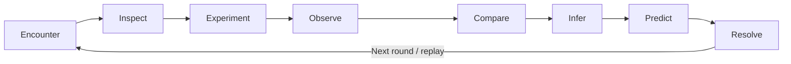

The challenge workspace remains the centre of the product:

- **System:** what the player is investigating.
- **Input:** what the player can test.
- **Output:** what the system returns.
- **Experiment history:** the ordered evidence collected by the player.
- **Prediction:** the player's deliberate, committed answer.

The existing vanilla HTML, CSS and JavaScript frontend is retained initially. The backend moves from a prototype-oriented server into a modular Node.js application with progressive TypeScript adoption. PostgreSQL becomes the system of record. The deterministic game engine is isolated from HTTP, persistence, identity and presentation concerns.

### The architecture at a glance

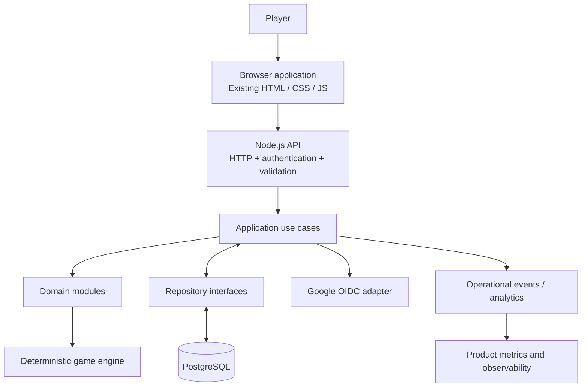

The first production implementation does not introduce AI into authoritative gameplay. It does not use LLM output to generate game results, determine correctness, calculate scores, alter hidden state or adjudicate rewards. Internal AI-assisted challenge ideation or QA drafting may be considered only as an optional, separately controlled workflow. Every candidate challenge remains subject to schema validation, deterministic execution tests and human approval.

The initial release also does not require microservices, Kubernetes, Redis, a vector database, RAG, model fine-tuning, a GPU inference service or multi-agent orchestration. These technologies are deliberately excluded because Phase 4 found no current product requirement for them.

---

# 1. Engineering Principles & Implementation Invariants

Every implementation decision is governed by the architecture accepted in Phase 4 and the experience defined in Phase 3.

| Principle | Implementation rule |
|:--|:--|
| Determinism | The same challenge version, initial state and ordered inputs reproduce the same outputs and final state |
| Server authority | The browser never determines correctness, score, timer expiry, ownership, hidden state or reward balance |
| Evidence integrity | Every accepted experiment is stored with a stable sequence number and cannot silently disappear or be reordered |
| Hidden-rule protection | Private challenge definitions and internal state never enter player-facing payloads before resolution |
| Attempt isolation | One match or round cannot mutate another player's state |
| Reproducibility | A completed attempt can be replayed using its immutable challenge version, engine version and accepted input sequence |
| Idempotency | Retried requests cannot create duplicate experiments, predictions, rewards or purchases |
| Atomicity | A state transition and its corresponding records commit together or not at all |
| Ownership | Every player-owned resource is checked against the authenticated player or guest session |
| Compatibility | Existing player-facing behaviour is preserved unless an approved product decision changes it |
| Privacy | Only data required to operate the game, protect accounts and understand product usage is collected |
| Proportionality | New infrastructure is introduced only when a demonstrated product or operational need exists |
| Human approval | No AI-generated challenge definition is published without deterministic validation and human review |

### 1.1 The authoritative execution contract

For a stateless challenge:

\[
y = f(x)
\]

For a stateful challenge:

\[
(s_{t+1}, y_t) = F(s_t, x_t)
\]

The implementation must preserve this contract:

\[
\text{Challenge Version} + \text{Initial State} + \text{Ordered Inputs}
\Rightarrow
\text{Same Outputs and Final State}
\]

The engine receives explicit inputs and returns a calculated transition. It does not read browser state, query the database, call an external API or depend on unrecorded time or randomness.

### 1.2 Trust boundaries

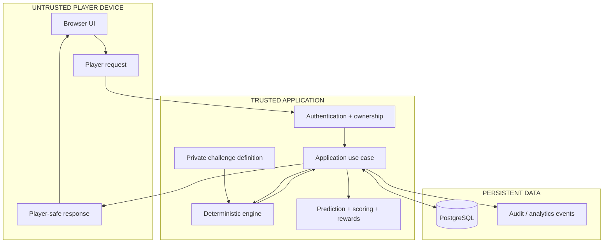

The browser is a presentation and input device. It is never the authority for game state.

### 1.3 Implementation evidence

A feature is not considered implemented merely because a route, screen, database table or configuration file exists. Each production capability requires evidence appropriate to its risk:

- Source code implementing the intended behaviour.
- Automated tests covering normal, invalid, duplicate and failure paths.
- Database constraints and transaction behaviour where state is persisted.
- Authorization tests for player-owned resources.
- Integration evidence for external providers.
- Deployment and runtime evidence for infrastructure-dependent behaviour.
- Operational documentation for recovery, rollback and incident handling.

A design decision, code stub, mocked response or successful local screen render is not production evidence.

---

# 2. Repository Foundation & Source-Code Management

### 2.1 Existing repository baseline

Phase 3 reviewed the supplied prototype structure. Its recorded QA report describes 19 passing automated tests; that is historical evidence from the supplied artefact, not a fresh Phase 5 test run.

| File | Existing responsibility | Phase 5 implementation direction |
|:--|:--|:--|
| `index.html` | HTML shell, viewport metadata, font loading and app entry point | Retain and refine |
| `styles.css` | Visual system, responsive layouts, components, animations and states | Retain; improve accessibility and consistency |
| `app.js` | Client screens, game interaction, modal state, API calls and rendering | Retain initially; split into focused browser modules |
| `server.js` | HTTP server, game rules, scoring, timers, player data, rewards and routes | Extract into modular application, domain and infrastructure layers |
| `package.json` | Project metadata, Node requirement and scripts | Pin supported runtime and dependency versions |
| `README.md` | Local setup, player flow and project guide | Extend with architecture and deployment instructions |
| `QA_REPORT.md` | Feature summary and recorded automated test results | Extend with production acceptance evidence |
| `tests/app.test.js` | Automated HTTP, game-rule and frontend integration tests | Preserve and expand |
| `data/db.json` | Local JSON-backed player data | Development-only; replace with PostgreSQL persistence |
| Process memory | Active match/session map | Replace with durable, database-backed state |

The supplied prototype uses `npm start`, runs through Node.js and serves the browser application. The HTML file is not intended to be opened directly because the game depends on `/api/*` endpoints. The existing QA report is not proof of production persistence, authentication or recovery.

### 2.2 Target repository structure

This is the target modular structure, not a claim that these files already exist.

```text
thinksy/
├── public/
│   ├── index.html
│   ├── assets/
│   ├── styles/
│   │   ├── tokens.css
│   │   ├── layout.css
│   │   ├── components.css
│   │   └── responsive.css
│   └── js/
│       ├── app.js
│       ├── api/
│       ├── components/
│       ├── screens/
│       ├── state/
│       └── utils/
├── src/
│   ├── app.ts
│   ├── server.ts
│   ├── config/
│   ├── domain/
│   │   ├── challenges/
│   │   ├── engine/
│   │   ├── matches/
│   │   ├── rounds/
│   │   ├── experiments/
│   │   ├── predictions/
│   │   ├── scoring/
│   │   ├── players/
│   │   ├── economy/
│   │   └── social/
│   ├── application/
│   │   ├── matches/
│   │   ├── experiments/
│   │   ├── predictions/
│   │   ├── identity/
│   │   ├── profile/
│   │   ├── economy/
│   │   └── social/
│   ├── infrastructure/
│   │   ├── database/
│   │   ├── repositories/
│   │   ├── identity/
│   │   ├── observability/
│   │   └── external/
│   └── http/
│       ├── routes/
│       ├── middleware/
│       ├── schemas/
│       └── responses/
├── challenges/
│   ├── schemas/
│   ├── manifests/
│   └── definitions/
├── migrations/
├── tests/
│   ├── unit/
│   ├── integration/
│   ├── contract/
│   ├── security/
│   └── e2e/
├── docs/
│   ├── architecture/
│   ├── api/
│   ├── operations/
│   └── decisions/
├── scripts/
├── .github/workflows/
├── .env.example
├── .gitignore
├── .nvmrc
├── package.json
├── package-lock.json
├── tsconfig.json
├── README.md
└── QA_REPORT.md
```

The exact file boundaries may be adjusted during extraction, but dependency direction remains consistent:

- Domain modules contain game and business rules.
- Application modules coordinate use cases and transactions.
- Infrastructure modules implement database, identity-provider and monitoring adapters.
- HTTP modules validate requests, authenticate callers and translate application results into API responses.
- Browser modules render the experience and submit user intent.
- The deterministic engine does not depend on the HTTP framework, database client or browser.

### 2.3 Version-control policy

- The main branch always represents a buildable, reviewed state.
- Work is developed in short-lived feature branches.
- Every change is submitted through a pull request.
- Pull requests describe the problem, implementation, tests, migration impact and risk.
- At least one review is required before merge; security-sensitive changes require review from the designated technical owner.
- No direct production edits are permitted.
- Database migrations are committed with the code that requires them.
- Generated build output, local databases, credentials, logs and private environment files are excluded from source control.
- Release tags identify deployed versions.
- Reverting a release must not silently reverse or corrupt committed player data.

### 2.4 Commit and pull-request standards

| Required item | Acceptance requirement |
|:--|:--|
| Purpose | Clear problem or requirement |
| Scope | Files and modules affected |
| Behaviour | Expected user and system behaviour |
| Tests | New and existing tests executed |
| Data impact | Migration, backfill and rollback/forward-fix implications |
| Security | Authentication, authorization, privacy and secret impact |
| UI impact | Screens, responsive behaviour and accessibility impact |
| Operations | Configuration, monitoring and deployment implications |
| Evidence | Screenshots, logs or test output where relevant |

---

# 3. Runtime, Language & Dependency Management

### 3.1 Runtime decision

Use a supported Node.js LTS release at implementation time. Pin the selected version in runtime configuration and CI. The prototype's `node >=18` declaration is a historical minimum, not the final production runtime policy.

The implementation must use the same supported Node.js major line in local development, CI and production; pin dependency versions through the lockfile; install dependencies reproducibly in CI; review dependency updates for security and compatibility; and record material dependency choices in an ADR.

### 3.2 Progressive TypeScript adoption

TypeScript is introduced first at boundaries where type safety reduces the greatest risk:

1. Domain entities and value types.
2. Challenge definitions and engine contracts.
3. Match, round and experiment state.
4. Prediction and scoring contracts.
5. Application use cases.
6. API request and response DTOs.
7. Repository interfaces and database adapters.

The existing browser frontend can remain JavaScript initially. The migration must not block preservation of the approved UI.

### 3.3 Dependency policy

| Dependency class | Policy |
|:--|:--|
| HTTP routing | Use a lightweight maintained router where extraction requires it; do not migrate frameworks for appearance |
| PostgreSQL client | Use a maintained Node PostgreSQL client with explicit transaction support |
| Schema validation | Use one consistent runtime validation approach at external boundaries |
| Authentication | Use a maintained OIDC verification library |
| Testing | Preserve the Node test runner or use an established browser-testing tool where needed |
| Logging | Use structured logging with redaction support |
| Monitoring | Select a provider after deployment and data-handling requirements are reviewed |
| UI framework | No mandatory React/Next.js rewrite |
| AI SDK | Not a runtime dependency for gameplay |

### 3.4 Configuration management

Configuration is read from environment variables through one validated configuration module. Application code must not read arbitrary environment variables throughout the codebase.

Configuration groups include runtime environment and port, public application origin, PostgreSQL connection, session secrets, Google OIDC client configuration, allowed origins and CSRF configuration, logging and monitoring, rate limits, data retention and session expiry.

The repository contains `.env.example` with variable names and safe placeholders only. It never contains usable credentials.

---

# 4. Frontend Engineering & Experience Preservation

### 4.1 Frontend implementation objective

The frontend implementation preserves the Phase 3 experience and connects it to stable server contracts. The goal is not a visual redesign. The goal is to remove prototype assumptions while retaining the visual language, interaction model and responsive behaviour already defined.

The existing dark arcade direction with fresh green accents, Manrope and DM Mono typography, machine illustration, evidence history, input controls, output chips, result states and motion behaviour remain the reference.

### 4.2 Frontend responsibilities

The browser owns rendering, input capture, player-safe challenge display, experiment-history presentation, loading and error states, a countdown based on server timing information, request submission and visible state updates from authoritative server responses.

The browser does not own hidden challenge definitions, authoritative match or round state, correctness, score or coin calculations, timer expiry decisions, player ownership, purchase authorization or reward granting.

### 4.3 Frontend module boundaries

| Module | Responsibility |
|:--|:--|
| Application shell | Initialisation, screen routing and global state boundaries |
| API client | Base URL, request headers, session credentials, JSON parsing and error mapping |
| Match setup | Mode/difficulty selection and match creation |
| Game workspace | System description, input controls, output display and evidence history |
| Prediction | Candidate selection and one-time prediction submission |
| Round result | Server result, score and rule explanation after resolution |
| Match result | Aggregate score, win/loss and eligible reward summary |
| Profile | Player-owned profile and progression projection |
| Leaderboard | Friends/global ranking presentation when enabled |
| Rewards shop | Catalogue, balance, inventory and equip state |
| Shared components | Buttons, cards, modal, toast, loading, empty and error states |

### 4.4 API client contract

All requests pass through one API client. Individual components do not construct arbitrary fetch calls or interpret raw server errors independently.

The API client sends credentials only to the approved origin, sets JSON headers where required, attaches request identifiers and idempotency keys, parses documented response envelopes, distinguishes authentication expiry from validation/conflict/rate-limit/service failures, and avoids automatic retries of non-idempotent operations without an idempotency key.

A sequence conflict triggers retrieval of authoritative match state. The UI never displays success before server confirmation.

### 4.5 UI state and recovery

| State | Required behaviour |
|:--|:--|
| Default | Show the next meaningful action |
| Hover | Restrained pointer feedback |
| Focus | Visible keyboard focus |
| Selected | Clear selected mode, difficulty or output |
| Used | Show that an input has already been tested |
| Disabled | Prevent an unavailable action |
| Processing | Explain processing and prevent duplicate submission |
| Success | Confirm the server-confirmed action |
| Incorrect | Distinct feedback and rule reveal after resolution |
| Timeout | Explain expiry and zero-point result |
| Empty | Explain what content will appear and how to create it |
| Error | Explain the issue and next safe recovery action |
| Modal | Clear open, close, focus and scroll behaviour |

A failed request must not leave controls permanently disabled. The UI must preserve current match context when the server has not resolved or invalidated the round. State-changing responses replace local assumptions.

### 4.6 Responsive and accessibility implementation

The Phase 3 breakpoints and viewport-first layout remain implementation references: `1024px`, `900px`, `720px`, `480px`, `360px`, short-height desktop handling and `prefers-reduced-motion`.

Acceptance includes no horizontal overflow on primary screens; comfortably tappable controls; understandable input/output evidence associations; accessible prediction on mobile; legible score, clue budget and timer; stacked panels when width is insufficient; scrollable modals; keyboard operation; visible focus; focus restoration; colour not being the only state indicator; reduced-motion support; and contrast measured against final rendered surfaces.

Responsive QA includes 320px width and short desktop viewport heights. CSS breakpoints alone do not prove responsive quality.

### 4.7 Frontend layout contract

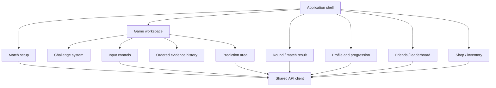

---

# 5. Backend Engineering & Modular Application Architecture

### 5.1 Backend implementation objective

The prototype's `server.js` combines HTTP handling, game rules, scoring, timers, player data, rewards and routes. Phase 5 separates these responsibilities while preserving existing API behaviour during migration.

The backend remains a modular monolith: one deployable application with explicit domain, application, infrastructure and HTTP boundaries.

### 5.2 Module responsibilities

| Layer | Responsibility | Must not own |
|:--|:--|:--|
| HTTP | Routes, request parsing, authentication middleware, validation and response mapping | Game rules and direct business calculations |
| Application | Use-case orchestration, transaction boundaries and coordination | Browser rendering or provider-specific HTTP details |
| Domain | Challenge rules, state transitions, match lifecycle, prediction and scoring rules | Database clients, cookies or HTTP request objects |
| Infrastructure | PostgreSQL repositories, OIDC adapter, logging and external provider integration | Product decisions |
| Frontend | Presentation and player intent | Authoritative state and private rules |

### 5.3 Application use cases

Implement explicit use cases for guest session creation/resumption; Google identity verification and linking; current-player retrieval; challenge listing; match creation and retrieval; experiment submission; prediction; timeout resolution; round advancement; match abandonment/completion; profile/progression retrieval; leaderboard retrieval; shop catalogue/inventory; cosmetic purchase/equip; and friend invitation lifecycle.

Each use case defines its actor, ownership rule, validation, transaction boundary, domain operations, persisted effects and player-safe projection.

### 5.4 Error handling

Validation errors return safe client errors. Authentication failures return unauthenticated responses. Ownership failures do not disclose another player's resource. Sequence and lifecycle conflicts return conflict responses. Rate-limit failures return rate-limit responses. Database unavailability becomes a controlled service failure. Unexpected exceptions are logged with a request ID and returned as generic internal errors.

Raw SQL errors, stack traces, session secrets, private challenge definitions and internal state are never returned to the browser.

### 5.5 Transaction ownership

Application use cases own transactions. Repository methods participate in the transaction supplied by the use case rather than independently committing partial changes.

For an experiment, the transaction includes:

1. Lock or otherwise safely serialize the active round.
2. Verify ownership and active status.
3. Check the expected sequence.
4. Check the idempotency record.
5. Validate player input against the challenge.
6. Execute the deterministic transition.
7. Insert the experiment with the next sequence number.
8. Persist the next state snapshot.
9. Update clue usage and relevant round state.
10. Record the operation result for idempotent replay.
11. Commit.

If any step fails, no partial experiment or state update is committed.

---

# 6. Domain Models & Typed Contracts

### 6.1 Core domain entities

The implementation uses explicit domain types for Player, Identity, Session, Challenge, Challenge Version, Public Challenge Manifest, Private Challenge Definition, Match, Round, Experiment, Prediction, Score Result, Player Statistics, Coin Ledger Entry, Cosmetic Item, Player Inventory Item, Friend Invitation, Friendship and Analytics Event.

### 6.2 Core lifecycle types

Illustrative TypeScript contracts:

```ts
type MatchStatus =
  | "active"
  | "completed"
  | "abandoned"
  | "expired";

type RoundStatus =
  | "active"
  | "correct"
  | "incorrect"
  | "timed_out"
  | "abandoned";

type MatchMode =
  | "practice"
  | "classic"
  | "time_trial";

type Difficulty =
  | "easy"
  | "medium"
  | "hard";

type ExperimentInput = {
  value: number;
};

type ExperimentOutput = {
  value: number;
};

type EngineResult<TState, TOutput> = {
  nextState: TState;
  observableOutput: TOutput;
};
```

These examples describe the intended typed boundary. Final field names and types must be reconciled with the actual challenge catalogue and Phase 4 data model before they are treated as canonical.

### 6.3 State-transition model

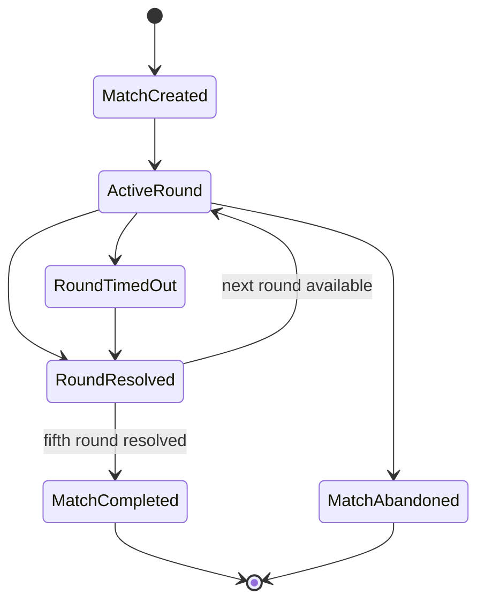

The diagram represents lifecycle intent. The implementation encodes allowed transitions in domain operations and tests every permitted and rejected transition.

### 6.4 Domain invariants

- A match contains the configured five rounds.
- A round references one immutable challenge version.
- A round has at most one committed prediction.
- A completed or timed-out round cannot accept a new experiment.
- Experiment sequence numbers are unique within a round.
- An invalid experiment does not mutate state or consume a clue.
- The server calculates score and reward eligibility.
- A completed match cannot be reopened by a client request.
- A player cannot access another player's match by changing an identifier.
- A challenge version cannot be modified after publication.
- A historical round remains associated with the challenge and engine versions used to execute it.

---

# 7. Challenge Catalogue & Deterministic Engine Implementation

### 7.1 Challenge data separation

Every challenge has two projections.

**Public manifest** — safe to deliver to the browser:

- Challenge ID and version.
- Title and introduction.
- Objective and instructions.
- Input format and visible constraints.
- Public category and difficulty.
- Display configuration.
- Permitted player-facing hints.

**Private definition** — server-only:

- Initial internal state.
- Hidden transformation or transition configuration.
- Private input constraints.
- Prediction target or evaluation rule.
- Scoring parameters where challenge-specific.
- Explanation revealed only after resolution.
- Engine type and compatible engine version.

A response DTO is constructed from the public manifest. The private definition is never serialised and then partially hidden in the frontend.

### 7.2 Challenge schema and validation

Challenge definitions are structured and versioned. Validation occurs at multiple levels:

1. JSON/schema validation.
2. Semantic validation of required fields and constraints.
3. Engine compatibility validation.
4. Deterministic execution tests.
5. Challenge-quality review.
6. Human approval before publication.

Valid JSON is not automatically a valid or fair challenge.

### 7.3 Challenge version lifecycle

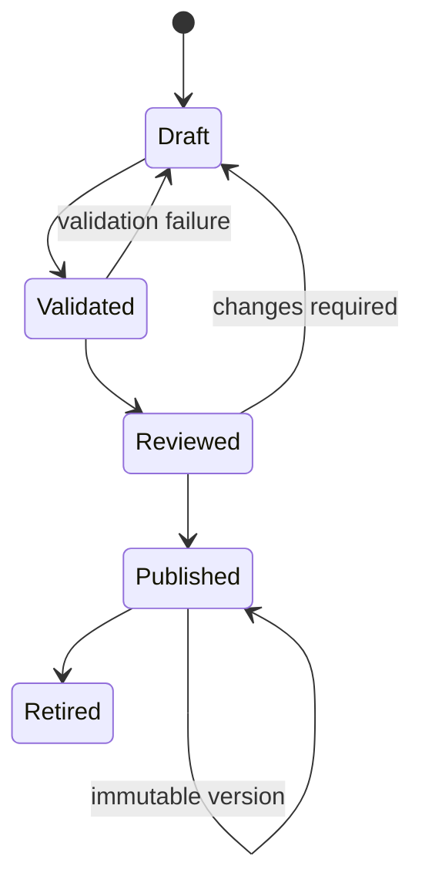

A published challenge version is immutable. A correction creates a new version. Existing matches continue to reference the original version.

### 7.4 Engine interface

The engine accepts a private challenge definition, authoritative state and validated player input. It returns the next state and player-observable output.

```ts
type EngineContext<TState, TInput> = {
  challengeVersion: number;
  engineVersion: string;
  state: TState;
  input: TInput;
};

type EngineResult<TState, TOutput> = {
  nextState: TState;
  observableOutput: TOutput;
};

interface ChallengeEngine<TState, TInput, TOutput> {
  execute(
    context: EngineContext<TState, TInput>
  ): EngineResult<TState, TOutput>;
}
```

The production engine registry contains only engine families required by the curated challenge catalogue. It does not accept arbitrary JavaScript, `eval`, uploaded scripts or untrusted executable challenge code.

### 7.5 Engine execution sequence

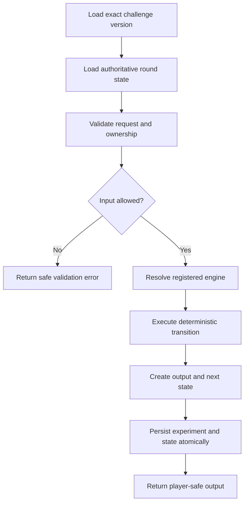

### 7.6 Determinism controls

| Risk source | Implementation control |
|:--|:--|
| Unseeded randomness | Prohibited in challenge execution |
| Current system time | Not an implicit engine input |
| External API response | Not permitted inside an engine transition |
| Shared mutable state | Prohibited |
| Browser-provided state | Never authoritative |
| Unstable collection order | Explicit ordering |
| Floating-point ambiguity | Prefer integer/decimal-safe rules or explicit tolerances |
| Runtime variation | Pin runtime and replay historical test vectors |
| Engine changes | Preserve compatible engine versions for historical replay |

If a future challenge requires randomness, the seed is explicit, persisted and included in replay inputs.

### 7.7 Replay harness

The replay harness loads the immutable challenge version, compatible engine version, initial state, accepted experiments in sequence order, recorded outputs and final state. It re-executes the sequence and compares each output and final state with the persisted record. Any mismatch is a correctness defect and blocks release.

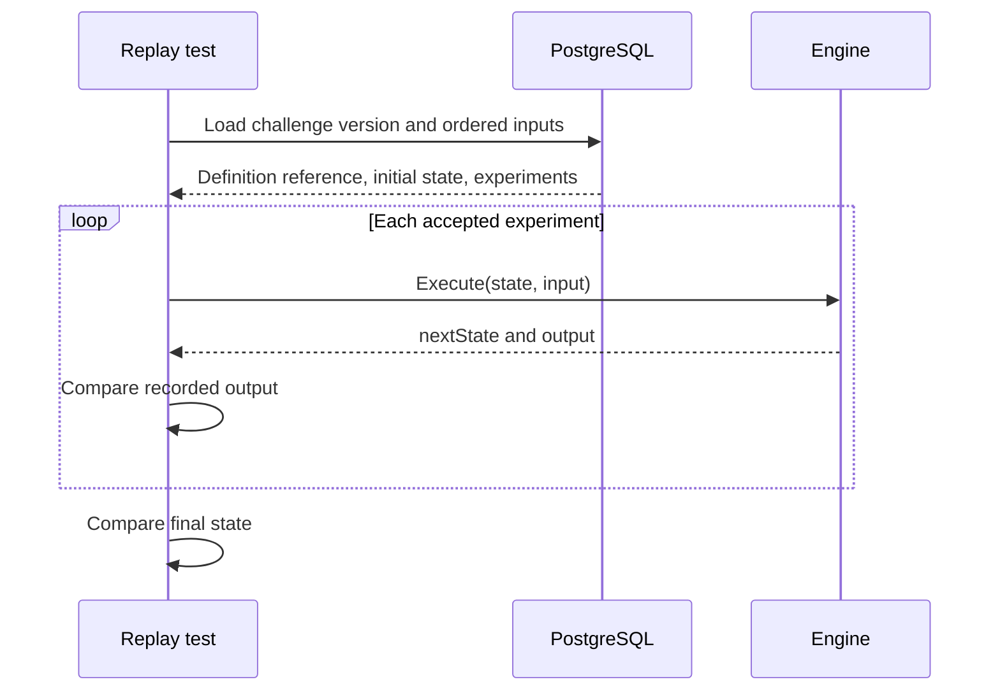

### 7.8 Challenge acceptance

A challenge is publishable only when public/private projections are separated; schema and semantic constraints pass; its engine type is registered; inputs are bounded and validated; repeated execution is deterministic; expected outputs and prediction target are independently tested; private fields cannot leak through API responses or logs; the explanation matches the actual rule; and a human reviewer approves it.

---

# 8. Match, Round, Experiment & Prediction Implementation

### 8.1 Match creation

The match-creation use case authenticates or establishes the guest player, validates mode and difficulty, applies fixed-mode rules on the server, creates the match, selects approved challenge versions, creates the initial round, stores initial authoritative state and deadline where applicable, and returns a player-safe match projection.

The client cannot choose private challenge IDs, hidden rules, internal state, score or reward values.

### 8.2 Experiment submission

The experiment endpoint validates session and match ownership, lifecycle, challenge version, input schema and constraints, clue budget, duplicate-input policy, expected sequence, idempotency key, request rate and request size.

Accepted experiments are ordered and durable. A duplicate network request returns the original operation result where the idempotency contract permits it. A reused key with a different payload is rejected.

### 8.3 Prediction submission

Prediction is a separate, one-time, server-authoritative operation. The server confirms the round is active and the minimum experiment requirement is met; validates the selected prediction; evaluates it against the private definition; calculates points through the approved scoring function; resolves the round exactly once; stores the result and explanation eligibility; and returns the player-safe result.

The browser never sends trusted `correct`, `score`, `reward` or `roundStatus` fields.

### 8.4 Timer implementation

- Practice has no countdown.
- Classic uses the timer assigned to the selected difficulty.
- Time Trial uses the Hard timer.
- The server records authoritative round start and deadline.
- The client displays remaining time using server-provided timing information.
- The server resolves expiry; a client-side timeout event is not proof that a round expired.
- A delayed client cannot extend the deadline.
- Timeout resolution is idempotent and cannot award points twice.

### 8.5 Round and match completion

A round is resolved once. The next round is available only after resolution. The server rejects advance requests before the current round is resolved or after the final round.

At the end of round five, the server calculates aggregate score, win/loss, performance summary, player statistics and eligible rewards. The client displays those values without recalculating them.

### 8.6 Match recovery

A player can refresh the browser and retrieve the current match from the server. An application restart must not erase an active match. Recovery reconstructs player-safe state from PostgreSQL, the immutable challenge version and the persisted state snapshot.

### 8.7 Experiment request lifecycle

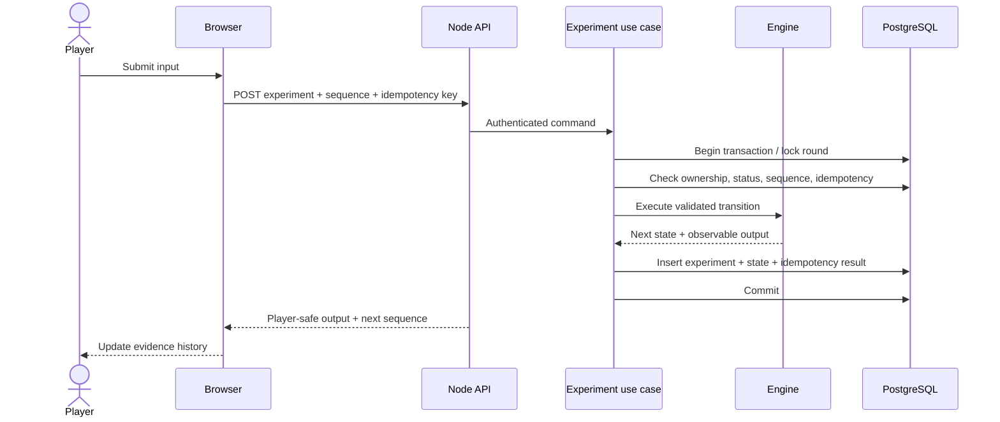

---

# 9. PostgreSQL Implementation & Data Persistence

### 9.1 Database decision

PostgreSQL is the system of record. Relational tables hold identity, ownership, lifecycle, transaction and relationship data. JSONB is used only for bounded, versioned challenge manifests and variable payloads where a relational representation is not appropriate.

### 9.2 Core tables

| Table | Responsibility |
|:--|:--|
| `players` | Player profile and account status |
| `identities` | Verified external identity mappings |
| `sessions` | Hashed opaque session tokens and expiry |
| `challenges` | Stable challenge identity |
| `challenge_versions` | Immutable public/private challenge versions |
| `matches` | Player-owned match lifecycle and aggregate state |
| `rounds` | Round lifecycle, challenge version and authoritative state snapshot |
| `experiments` | Ordered input/output evidence |
| `predictions` | One committed prediction and its result |
| `player_stats` | Derived player progression and statistics |
| `coin_ledger` | Immutable coin credits and debits |
| `cosmetic_items` | Shop catalogue |
| `player_inventory` | Owned cosmetic items and equipped state |
| `friend_invitations` | Invitation lifecycle |
| `friendships` | Accepted player relationships |
| `analytics_events` | Minimal product event records |
| `idempotency_records` | Stored operation identity and replayable response metadata |

The final column definitions, constraints and indexes must match the Phase 4 relational model and actual query patterns. This section defines implementation responsibilities; it does not assert that migrations have already been executed.

### 9.3 Relationship model

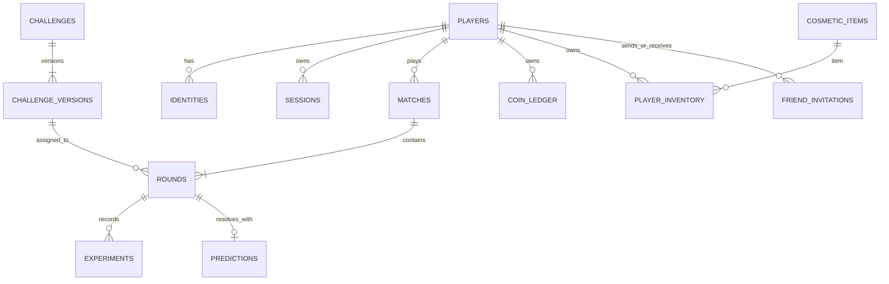

The diagram shows the principal ownership relationships. Exact cardinality, foreign-key actions and field constraints are defined in the migration schema.

### 9.4 Migration strategy

Every schema change is a version-controlled migration. Migrations run in CI against a clean PostgreSQL database and are tested against the supported PostgreSQL version. Production migrations are applied through a controlled deployment step. Destructive changes use expand-and-contract. Large backfills are separated from schema deployment where necessary. Migration status is observable. Rollback or forward-fix behaviour is documented before production execution.

### 9.5 Transaction requirements

| Operation | Atomic records |
|:--|:--|
| Create match | Match, selected rounds, initial state and challenge references |
| Submit experiment | Experiment, sequence, next state snapshot, clue count and idempotency record |
| Submit prediction | Prediction, round result, score and result event |
| Complete match | Match completion, aggregate result, stats update and eligible reward entries |
| Purchase cosmetic | Coin debit, ledger entry, inventory grant and idempotency record |
| Equip cosmetic | Ownership validation and equipped-state update |
| Accept friend invitation | Invitation transition and canonical friendship creation |

### 9.6 Data integrity controls

Foreign keys protect relationships. Unique constraints prevent duplicate identities and sequence numbers. Check constraints enforce valid states and non-negative values where applicable. Transactions protect multi-record operations. Ownership checks remain in application logic even when UUIDs are used. The coin ledger is append-only from application operations. Player balance is derived from or reconciled against ledger entries; the browser cannot set it. Published challenge versions cannot be updated in place. Indexes are added for measured query patterns, not speculatively.

### 9.7 Persistence acceptance

Migrations run on a clean database; match creation and round progression persist; experiment ordering survives refresh and restart; predictions and results cannot be duplicated; purchases cannot create a negative balance or duplicate unique inventory; referential integrity is enforced; and backup restoration is tested in a non-production environment before launch.

---

# 10. API Implementation & Third-Party Integrations

### 10.1 API contract

The API uses REST/JSON, explicit schemas, stable error codes, ownership checks and idempotency for retryable state-changing operations.

The versioned API contract is stored with the repository as an OpenAPI specification. It is the shared contract for frontend implementation, backend routes, tests and future clients.

### 10.2 Endpoint implementation map

| Method | Endpoint | Implementation responsibility |
|:--|:--|:--|
| `GET` | `/api/v1/health` | Process liveness |
| `GET` | `/api/v1/ready` | Readiness, including database connectivity |
| `GET` | `/api/v1/me` | Current player/session |
| `POST` | `/api/v1/auth/google` | Verify Google credential and establish session |
| `POST` | `/api/v1/auth/logout` | Revoke current session |
| `GET` | `/api/v1/challenges` | List published public manifests |
| `GET` | `/api/v1/challenges/{id}` | Retrieve public challenge details |
| `POST` | `/api/v1/matches` | Create a five-round match |
| `GET` | `/api/v1/matches/{id}` | Retrieve player-owned authoritative match projection |
| `POST` | `/api/v1/matches/{id}/rounds/{roundId}/experiments` | Submit one experiment |
| `POST` | `/api/v1/matches/{id}/rounds/{roundId}/prediction` | Submit committed prediction |
| `POST` | `/api/v1/matches/{id}/advance` | Advance after round resolution |
| `POST` | `/api/v1/matches/{id}/abandon` | Abandon active match |
| `GET` | `/api/v1/profile` | Player statistics and progress |
| `GET` | `/api/v1/leaderboard` | Friends/global read model when enabled |
| `GET` | `/api/v1/shop` | Catalogue, balance and inventory |
| `POST` | `/api/v1/shop/purchases` | Purchase cosmetic item |
| `POST` | `/api/v1/shop/equipped-item` | Equip an owned cosmetic |
| `POST` | `/api/v1/friend-invitations` | Create friend invitation |
| `POST` | `/api/v1/friend-invitations/{id}/accept` | Accept invitation |

### 10.3 Legacy route migration

| Existing route | Target domain operation |
|:--|:--|
| `/api/match` | `POST /api/v1/matches` |
| `/api/move` | `POST .../experiments` |
| `/api/guess` | `POST .../prediction` |
| `/api/next` | `POST /api/v1/matches/{id}/advance` |
| `/api/timeout` | Server-side deadline resolution |
| `/api/exit` | `POST /api/v1/matches/{id}/abandon` |
| `/api/auth/google` | Verified OIDC credential validation |
| `/api/friends/add` | Durable invitation creation and acceptance |
| `/api/shop/purchase` | Transactional purchase operation |
| `/api/shop/equip` | Inventory-checked equip operation |

The migration preserves the player's mental model. Legacy routes may be retained temporarily behind adapters during transition, but there must be one authoritative implementation of each domain operation.

### 10.4 Request and response contracts

Example experiment request:

```json
{
  "input": {
    "value": 4
  },
  "expectedSequence": 3
}
```

The request uses an `Idempotency-Key` header. It does not contain authoritative internal state, hidden challenge configuration or a client-calculated output.

Example player-safe response:

```json
{
  "data": {
    "experimentId": "uuid",
    "sequence": 3,
    "output": {
      "value": 8
    },
    "cluesUsed": 3,
    "cluesRemaining": 4,
    "roundStatus": "active"
  },
  "meta": {
    "requestId": "request-uuid"
  }
}
```

The exact payload must match the final OpenAPI schema and engine output types.

### 10.5 Error contract

| HTTP status | Code | Meaning |
|:--:|:--|:--|
| 400 | `INVALID_REQUEST` | Malformed request |
| 400 | `INVALID_INPUT` | Input does not match the challenge |
| 401 | `UNAUTHENTICATED` | Missing or invalid session |
| 403 | `FORBIDDEN` | Caller does not own the resource |
| 404 | `NOT_FOUND` | Resource does not exist or is not visible |
| 409 | `SEQUENCE_CONFLICT` | Expected sequence is stale |
| 409 | `IDEMPOTENCY_CONFLICT` | Key reused with a different payload |
| 409 | `ROUND_NOT_ACTIVE` | Round is completed or expired |
| 409 | `MATCH_NOT_ACTIVE` | Match cannot accept the operation |
| 413 | `PAYLOAD_TOO_LARGE` | Request exceeds size limit |
| 422 | `CHALLENGE_CONSTRAINT_VIOLATION` | Valid format but prohibited by challenge rules |
| 429 | `RATE_LIMITED` | Request frequency exceeded |
| 500 | `INTERNAL_ERROR` | Unexpected server error |
| 503 | `SERVICE_UNAVAILABLE` | Temporary dependency failure |

### 10.6 Third-party integration register

| Integration | Purpose | Required control | Launch condition |
|:--|:--|:--|:--|
| Google OpenID Connect | Verified account identity | Server-side token verification, issuer/audience/expiry checks and stable provider subject | Required for persistent Google sign-in |
| Managed PostgreSQL | Durable application data | TLS, private/restricted network access, least-privilege credentials and backup policy | Required |
| Hosting provider | Run Node application and serve assets | Environment separation, secret injection, health checks and rollback path | Required |
| Error/monitoring provider | Runtime error and performance visibility | PII redaction, access control and retention review | Select before production launch |
| Email provider | No core first-release requirement established | Do not add without an approved product requirement | Not assumed |
| Analytics provider | Server-side product measurement is defined first | Minimise personal data and review consent/retention | Provider selection remains implementation verification |

An integration is not complete because credentials have been added. It must have a working integration test, failure handling, security review and documented operational behaviour.

### 10.7 OpenAPI and contract testing

The OpenAPI document records each operation's method, path, authentication, ownership rule, request and response schema, error codes, idempotency behaviour, rate-limit class and mutation boundary. CI validates the specification and runs contract tests against the implementation. Breaking changes require an explicit versioning or compatibility decision.

---

# 11. Authentication, Authorization & Session Management

### 11.1 Guest-first identity

A player can begin the core game without creating a permanent account. The server creates or resumes a guest identity and issues an opaque session token.

The session token is stored in a secure, HTTP-only cookie. Only a hash or non-reversible representation is stored server-side where the selected session design requires it. The cookie uses appropriate `Secure`, `HttpOnly` and `SameSite` attributes, with CSRF protection for state-changing requests.

### 11.2 Google OpenID Connect

The production flow verifies the Google identity credential on the server. The implementation validates signature against Google's published keys through a maintained verification library; issuer; audience/client identifier; expiry and issued-at constraints; stable `sub` provider identifier; nonce/state where required by the selected flow; and account-linking policy.

A name, email address or avatar sent in a request body is not proof of identity. The prototype's Google-branded account-selection interface is not evidence of completed production OIDC.

### 11.3 Account linking

Guest-to-Google linking follows an explicit merge policy. The operation defines how match history, statistics, streaks, coins, inventory and existing identities are reconciled. Duplicate reward grants are prohibited. The user receives a clear outcome if linking cannot be completed safely.

### 11.4 Authorization

Every player-owned resource operation verifies ownership on the server. UUIDs are identifiers, not authorization.

Authorization tests cover match retrieval and mutation; round and experiment access; prediction submission; profile data; inventory and purchase history; friend invitations and friendship records; session revocation and account linking.

### 11.5 Session lifecycle

Sessions have explicit expiry, revocation and renewal behaviour. Logout revokes the server-side session. Passwords are not introduced because the selected identity direction is guest-first plus verified Google OIDC.

### 11.6 Identity flow

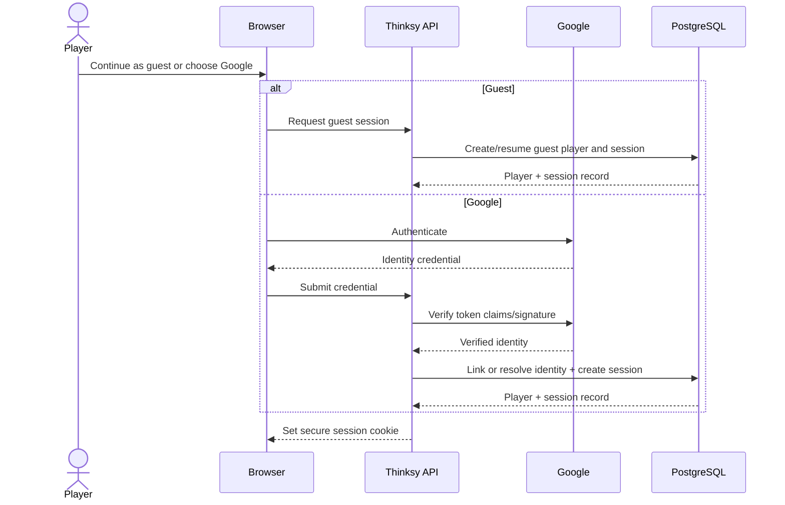

---

# 12. Profile, Progression, Social & Virtual Economy

Phase 3 includes profile, streak, rewards, shop, friend-code and leaderboard experiences. Phase 4 established durable data and integrity requirements. Phase 5 implements these features without allowing them to compromise the core game.

### 12.1 Profile and statistics

Profile data is returned as a player-owned projection. The server derives or updates statistics from completed match outcomes. The browser cannot submit authoritative win rate, high score, streak or coin balance.

### 12.2 Streaks and progression

Streak updates use server-side timestamps and an explicit timezone policy. Repeated requests cannot grant duplicate streak progress. Calculations are covered by boundary tests for date changes and retries.

### 12.3 Coin ledger

The coin ledger records each credit and debit as an immutable transaction with player identifier, transaction type, amount, source/reason, related match or purchase reference where applicable, idempotency key and creation timestamp.

The application never accepts a client-provided balance. Reward eligibility and amounts are calculated from approved server-side rules. A purchase debits coins and grants inventory in one transaction.

### 12.4 Cosmetic inventory

The shop catalogue contains item identity, category, display metadata, price and availability. Inventory records ownership and equipped state. Duplicate unique-item purchases are rejected. Equip operations require verified ownership.

### 12.5 Friends and leaderboard

Friend invitations have explicit states such as pending, accepted, declined, cancelled or expired. Self-invites and duplicate relationships are rejected. Friendship is stored as a canonical player pair with a uniqueness constraint.

Leaderboard data is a read model derived from approved player statistics. Ranking policy and source fields are documented. The leaderboard must not expose private email addresses or other unnecessary identity data.

### 12.6 Feature rollout order

The core match lifecycle, durable persistence and identity integrity take priority. Profile, social and cosmetic-economy features are enabled only after their transaction and authorization tests pass. Their presence in the interface does not justify shipping incomplete backend behaviour.

### 12.7 Purchase transaction

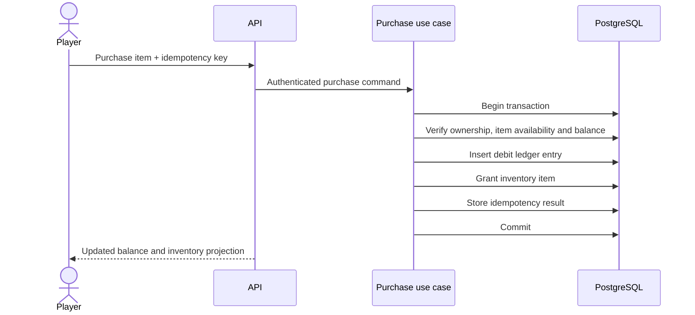

---

# 13. Data Pipelines, Analytics & Operational Events

### 13.1 Data strategy implementation

Thinksy's initial data pipeline is intentionally simple. Operational gameplay records remain in PostgreSQL. Minimal server-side analytics events are recorded using the Phase 4 event taxonomy. A separate warehouse or streaming platform is not introduced without measured need.

### 13.2 Event capture

Events are emitted from successful domain operations, not inferred from frontend button clicks alone.

Core event groups include player/session created or resumed; match started; round started; experiment accepted or rejected; prediction committed; round resolved; match completed or abandoned; reward credited; cosmetic purchased or equipped; and friend invitation created or accepted.

Each event includes a stable event name, timestamp, request/correlation identifier and minimum relevant player/match context. Private challenge definitions, session tokens and unnecessary personal data are excluded.

### 13.3 Processing sequence

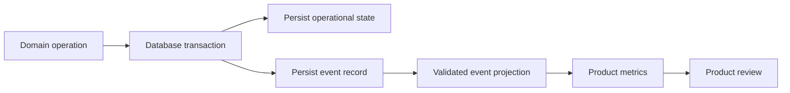

The event and state mutation must not diverge silently. Where events are required to be durable, they are written in the same transaction as the corresponding operation or through an explicitly designed outbox mechanism.

### 13.4 Product metrics and analytical views

Instrumentation supports the questions defined in earlier phases:

- Do players start a match?
- Do they complete rounds and matches?
- How many experiments do they use?
- Do they make predictions?
- How often do they replay?
- Do they understand scoring and results?
- Do they return?
- Does behaviour differ by mode, difficulty or device class?

The following are measurement views, not invented target values:

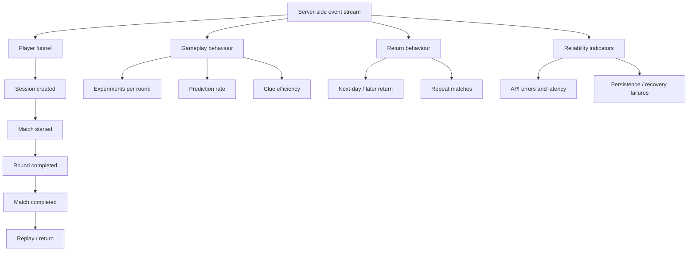

Do not create arbitrary success thresholds before a reliable baseline exists. Product metrics support learning; they do not replace moderated player research.

### 13.5 Data governance

Every data class has a purpose, owner, access boundary, retention rule and deletion behaviour. Operational gameplay data, restricted identity data, analytics events and qualitative research records remain logically separated. Access is role-based and logged. Exports exclude hidden rules, session secrets and unnecessary identity fields.

---

# 14. AI Development & Model Integration Boundary

### 14.1 AI implementation decision

Thinksy is a deterministic reasoning game. Its promise depends on the player discovering a consistent system from evidence. AI must not become the authority for the behaviour being investigated.

The Phase 4 decision remains binding in Phase 5:

**No AI model is integrated into authoritative gameplay.**

The game engine, prediction evaluator, scoring, timer resolution, reward calculation and match state transitions remain deterministic application code.

### 14.2 AI technology disposition

| Technology | Phase 5 disposition | Reason |
|:--|:--|:--|
| LLMs | Not used in gameplay | Generated output cannot guarantee deterministic fairness |
| Generative AI | Optional internal drafting only | Human review and deterministic validation remain mandatory |
| Machine learning | Not selected | No validated prediction or personalisation use case |
| Deep learning | Not selected | No current product requirement |
| Prompt engineering | Only if an internal drafting workflow is approved | Not a game runtime dependency |
| System prompts | Versioned internal workflow artefact only, if used | Must not govern authoritative game outcomes |
| Prompt templates/chaining | Not required for first release | No validated workflow requiring orchestration |
| Structured model outputs | Optional for internal challenge-draft proposals | Output is untrusted until schema and semantic validation |
| Embeddings/vector search | Not selected | Challenge catalogue does not require semantic retrieval infrastructure |
| RAG | Not selected | No approved knowledge-grounded AI feature |
| Fine-tuning | Not selected | No approved model use case or training dataset |
| AI agents/tool calling | Not selected for product runtime | No autonomous action requirement |
| Multi-agent orchestration | Not selected | Adds complexity without product value |
| Multimodal AI | Not selected | No validated multimodal requirement |
| Model serving/inference stack | Not required | No production model is selected |

### 14.3 Permitted internal workflow

If internal AI assistance is used for challenge ideation or QA drafting, it is limited to producing a candidate artefact. The workflow must:

1. Use an approved, versioned system prompt and task template.
2. Provide only the information required for the drafting task.
3. Request a structured proposal rather than executable code.
4. Treat all model output as untrusted.
5. Validate output against the challenge schema.
6. Run semantic and deterministic engine tests.
7. Check that the challenge is fair, solvable and does not leak its rule.
8. Require human review and approval.
9. Record the model/workflow version and reviewer decision where auditability is required.
10. Publish only through the normal challenge-version lifecycle.

The model cannot publish a challenge, modify production challenge data, call production game APIs or alter a player's match.

### 14.4 AI-assisted challenge workflow

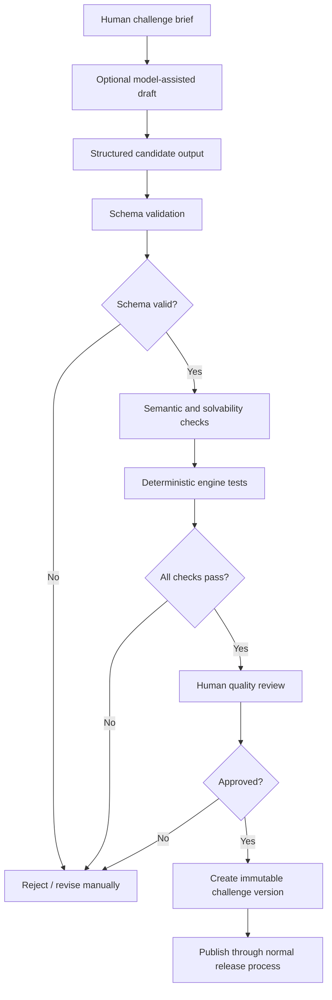

### 14.5 Model selection and benchmarking

No production model is selected because no production AI use case has been approved. A benchmark is not claimed as completed.

If an internal AI workflow is approved later, compare candidate models against a fixed evaluation set for schema validity, factual consistency, challenge quality, latency, cost, privacy and reviewer correction effort. The selected model must outperform the non-AI baseline sufficiently to justify the additional operational and governance burden.

### 14.6 AI fallback

The internal drafting workflow is optional. If the model is unavailable, produces invalid output or fails quality review, the existing human-authored challenge workflow continues. Gameplay never depends on model availability.

---

# 15. Security Engineering & Privacy Controls

### 15.1 Security objectives

1. Protect player identity and sessions.
2. Prevent access to another player's matches and records.
3. Keep private challenge rules and internal state server-side.
4. Prevent manipulation of score, timers, rewards and purchases.
5. Protect the database and production credentials.
6. Limit abuse through validation, rate limits and request-size controls.
7. Prevent accidental exposure through logs, errors and analytics.
8. Maintain recoverability through backup and incident procedures.

### 15.2 Application controls

Validate every request at the server boundary; use parameterised SQL; apply object-level authorization to every player-owned resource; use secure, HTTP-only session cookies; enforce CSRF protection for cookie-authenticated state-changing requests; configure CORS for approved origins only; apply rate limits to authentication, match creation, experiments, predictions, invitations and purchases; enforce request-body size limits; reject arbitrary code and `eval`; keep secrets out of source control and frontend assets; redact tokens, cookies and personal data from logs; use HTTPS in production; keep PostgreSQL off the public internet where supported; use least-privilege database credentials; and review dependency vulnerabilities before release.

### 15.3 Abuse and integrity cases

| Threat | Required control |
|:--|:--|
| BOLA / IDOR | Ownership checks on every resource operation |
| Hidden-rule extraction | Public/private DTO separation and response tests |
| Client score manipulation | Server-calculated score |
| Timer manipulation | Server deadline and idempotent timeout resolution |
| Duplicate experiment | Idempotency key and unique sequence |
| Concurrent experiment race | Transactional serialization/locking and sequence constraint |
| Duplicate purchase | Atomic transaction and idempotency |
| Coin balance tampering | Immutable ledger and server-side balance logic |
| Session theft | Secure cookie attributes, TLS, rotation/revocation and session expiry policy |
| CSRF | SameSite policy and CSRF token/origin validation as appropriate |
| Injection | Parameterised queries and schema validation |
| Abuse/spam | Rate limits and operational alerts |
| Secret leakage | Secret manager/runtime injection and log redaction |

### 15.4 Security control layers

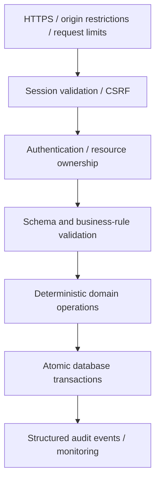

### 15.5 Privacy and retention

Collect only information required for identity, gameplay continuity, product learning and abuse prevention. Retention durations and deletion behaviour are explicit launch policies. Guest progress and account-linking consequences are communicated to players where they affect continuity.

---

# 16. Automated Testing & Quality Engineering

### 16.1 Testing strategy

Testing is layered. Unit tests validate domain logic; integration tests validate persistence and transactions; contract tests validate the API; security tests validate authorization and abuse controls; end-to-end tests validate the player journey.

The historical 19-test QA report is retained as prototype evidence. It is not a substitute for the new production test suite.

### 16.2 Testing pyramid

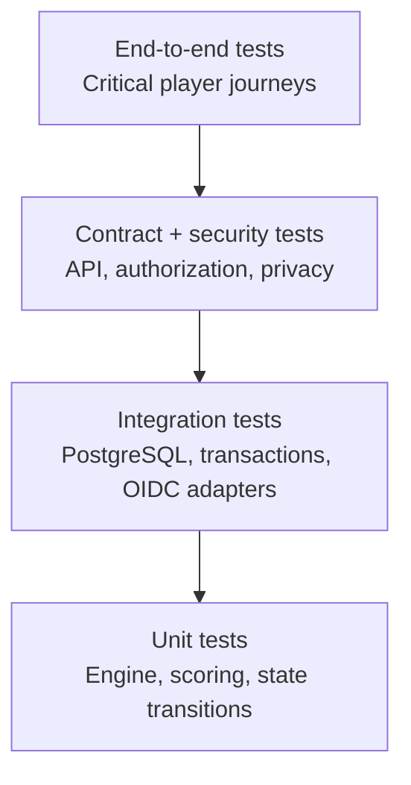

The pyramid communicates test scope, not a numerical test-count target. Most deterministic domain behaviour should be tested at unit level; expensive end-to-end tests are reserved for critical integrated journeys.

### 16.3 Unit tests

Cover challenge schema and semantic validation; engine transitions; deterministic replay; input validation; clue-budget rules; prediction evaluation; scoring; timeout calculation; match and round lifecycle transitions; streak calculations; reward eligibility; ledger arithmetic; and friend invitation transitions.

### 16.4 Integration tests

Run against a real test PostgreSQL instance or equivalent isolated database environment. Cover migrations from an empty database, repository operations, transaction rollback, experiment ordering, duplicate and concurrent requests, match recovery, prediction idempotency, purchase atomicity, inventory uniqueness, account linking, session revocation and friendship uniqueness.

### 16.5 API contract tests

Validate request schema, response schema, authentication requirement, ownership rules, error mapping, idempotency behaviour, rate-limit response, public/private challenge separation and OpenAPI consistency.

### 16.6 End-to-end tests

Critical player journeys:

1. Open Thinksy and begin as a guest.
2. Select Practice and start a match.
3. Submit experiments and inspect ordered evidence.
4. Submit a prediction.
5. View the round result.
6. Complete all five rounds.
7. Refresh during an active match and recover state.
8. Restart the application and recover the match.
9. Link a Google identity and resume the account.
10. Review profile and progression.
11. Purchase and equip a cosmetic item.
12. Create and accept a friend invitation where social features are enabled.
13. Complete representative journeys on mobile and desktop.

### 16.7 Determinism and concurrency tests

- Same challenge version and ordered inputs always produce the same output sequence.
- Replay reproduces every stored output and the final state.
- Invalid inputs do not mutate state or consume clues.
- Two concurrent submissions cannot claim the same sequence.
- Repeated idempotent requests do not create duplicate experiments.
- A prediction can resolve a round only once.
- Timeout and prediction races resolve through one authoritative terminal transition.
- A failed transaction leaves no partial state.
- One player's operations do not mutate another player's match.

### 16.8 Security and privacy tests

Attempt to retrieve another player's match; submit an experiment to another player's round; inspect private challenge fields; submit client-calculated score or reward values; reuse an idempotency key with a different payload; bypass rate limits; use an expired or revoked session; and verify logs do not contain credentials, session tokens or private challenge definitions.

### 16.9 Accessibility and responsive QA

Test keyboard navigation, focus order, focus restoration, contrast, screen-reader labels, reduced motion, mobile touch targets, overflow, modals, loading states and error states across representative browser/device combinations.

### 16.10 Performance and load testing

Measure the critical experiment-submission path, match retrieval, match creation and prediction resolution under realistic workload assumptions. Report measured latency percentiles, error rates, throughput and database behaviour against Phase 4 service-level acceptance targets.

Do not report target values as achieved measurements. A performance claim requires a reproducible test report with environment, workload, dataset and test duration.

---

# 17. CI/CD & Automated Engineering Workflow

### 17.1 Continuous integration

Every pull request runs the required quality gates.

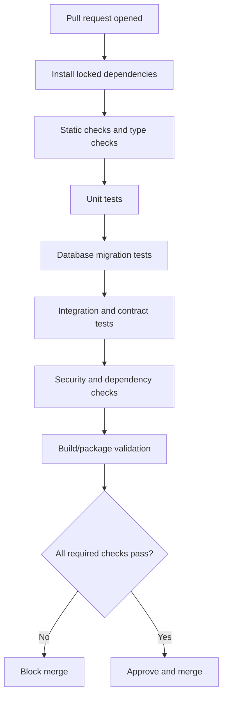

The diagram defines required gates; it is not a claim that the workflow has already run.

### 17.2 Continuous delivery

Deployment follows controlled environments:

1. Local development.
2. CI test environment.
3. Staging.
4. Production.

A production release requires a reviewed change, passing CI, migration review, configuration validation, smoke tests and an explicit release record.

### 17.3 Deployment gates

Build and type checks pass; unit, integration and contract tests pass; migrations are validated; no unresolved critical/high security finding remains without an approved exception; environment configuration is present and validated; health and readiness endpoints work; smoke tests pass; and monitoring plus rollback/forward-fix procedures are available.

### 17.4 Release strategy

Deploy application and database changes in a compatible order. Use expand-and-contract migrations for breaking schema changes. Where the hosting platform supports it, use staged rollout or a controlled release window. Monitor error rate, latency, database health and gameplay integrity after deployment.

A rollback must not destroy committed player transactions or leave the database schema incompatible with the running application. When reversing a migration is unsafe, use a forward fix.

### 17.5 Infrastructure configuration

Infrastructure is defined through provider configuration or infrastructure-as-code where appropriate. The selected provider and region remain subject to Phase 4 criteria: data residency, managed PostgreSQL, backup capability, network security, observability, availability, exportability and total cost.

The initial deployment remains a managed Node application and managed PostgreSQL. Kubernetes, service mesh, distributed queues and GPU infrastructure are not introduced for the first release.

### 17.6 Deployment topology

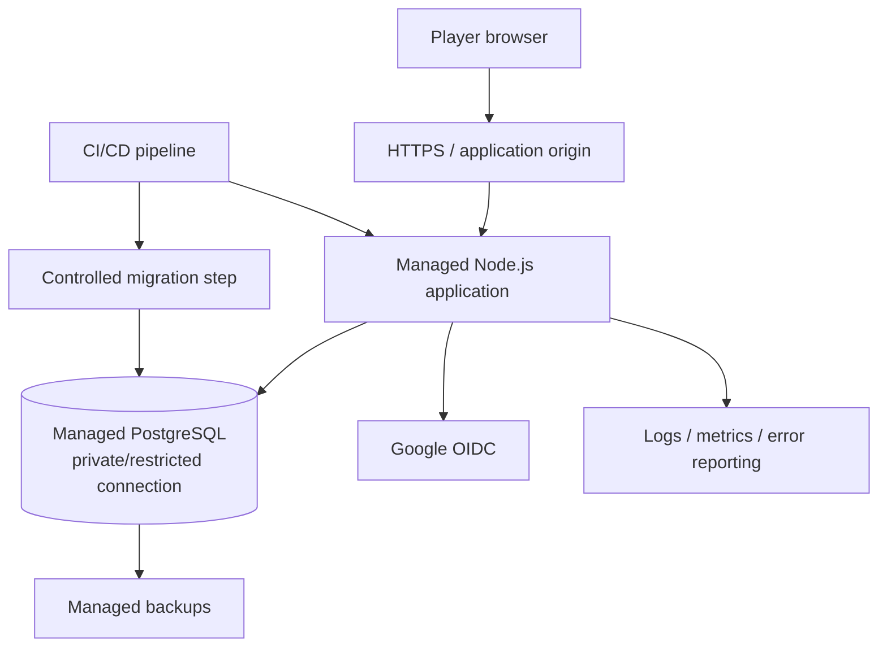

---

# 18. Environments, Deployment & Production Operations

### 18.1 Environment separation

| Environment | Purpose | Data policy |
|:--|:--|:--|
| Local | Development and debugging | Synthetic or developer-owned data |
| CI | Automated validation | Disposable test data |
| Staging | Release verification | Synthetic/test accounts; no unnecessary production personal data |
| Production | Live player experience | Protected operational data and restricted access |

Credentials, databases and provider resources are separate by environment.

### 18.2 Health and readiness

Liveness indicates that the application process is running. Readiness indicates that required dependencies, including PostgreSQL, are available. A database outage must not be reported as a healthy ready state. Health endpoints do not expose secrets, connection strings or internal diagnostics.

### 18.3 Backup and recovery

Automated database backups are configured with the selected provider. Backup retention follows the approved policy. Restoration is tested in a non-production environment. Recovery procedures record the responsible operator and verification steps. RPO and RTO targets are those defined in Phase 4 and must be tested rather than assumed. A backup that has never been restored is not considered verified.

### 18.4 Incident handling

Incidents are classified by player impact and data-integrity risk. Security, account access, hidden-rule leakage, match corruption and economy inconsistency require immediate escalation to the technical owner. Operational logs must support investigation without exposing secrets or private player information.

### 18.5 Production readiness

Production readiness requires more than a successful deployment. It requires verified identity, persistence, authorization, deterministic gameplay, recovery, monitoring, backup restoration, responsive QA and documented release procedures.

---

# 19. Sprint Execution & Engineering Ownership

### 19.1 Delivery sequence

Implementation follows the dependency order established in Phase 4.

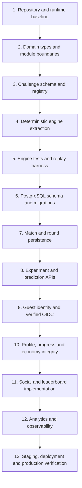

### 19.2 Workstream plan

| Workstream | Engineering output | Dependency | Acceptance evidence |
|:--|:--|:--|:--|
| Foundation | Runtime, configuration, repository structure and CI | None | Reproducible local and CI build |
| Domain model | Typed match, round, challenge and experiment contracts | Foundation | Type checks and domain tests |
| Challenge system | Versioned schema, registry and validator | Domain model | Invalid challenge cannot publish |
| Engine | Pure deterministic transition modules | Challenge system | Replay and determinism tests |
| Persistence | PostgreSQL schema and migrations | Domain model | Integration tests and constraints |
| Match service | Durable match and round lifecycle | Persistence | Refresh and restart recovery |
| Experiment API | Atomic, idempotent experiment execution | Engine and persistence | Duplicate and concurrency tests |
| Prediction API | Server-side evaluation and scoring | Challenge system | Correct, incorrect and timeout tests |
| Identity | Guest sessions and verified Google OIDC | Persistence | Token verification and session tests |
| Progress/economy | Stats, streaks, ledger and inventory | Identity and match | Atomic reward and purchase tests |
| Social | Durable invitations/friendships and leaderboard read model | Identity | Relationship and access-control tests |
| Analytics | Server-side event taxonomy | Domain operations | Event schema and privacy tests |
| Operations | Hosting, logs, metrics, backups and recovery | Critical modules | Staging and restore evidence |
| UX preservation | Connect existing UI to stable API | API contracts | Existing flow regression tests |

### 19.3 Sprint planning rules

Each sprint has a demonstrable engineering outcome. Work is sliced vertically where possible: a small user-visible capability with its domain logic, persistence, API, tests and interface integration.

Sprint commitments account for dependencies, migration risk and test evidence. A task is not complete when code is written; it is complete when acceptance criteria are met, reviewed and merged.

### 19.4 Definition of ready

A work item is ready when it has a clear user or system outcome; a reference to Phase 3 experience or Phase 4 architecture; defined inputs, outputs and state changes; acceptance criteria; identified dependencies; data and security impact; test expectations; and a clear owner.

### 19.5 Definition of done

A work item is done when implementation matches the approved contract; relevant tests pass; authorization and validation are covered; documentation is updated; no unresolved critical regression remains; code has been reviewed and merged; deployment impact is understood; and evidence is attached to the work item.

---

# 20. Engineering Documentation & Technical Debt

### 20.1 Required documentation

The repository maintains a root README with local setup and project overview; architecture overview and module dependency rules; OpenAPI specification; database schema and migration guide; challenge schema and authoring guide; engine interface and replay instructions; authentication and account-linking flow; environment variable reference; deployment and release procedure; backup and restore runbook; monitoring and incident runbook; test strategy and QA report; and ADRs for material technical decisions.

Documentation must describe the actual implementation. It must not retain outdated prototype instructions after the corresponding behaviour changes.

### 20.2 Architecture Decision Records

Any material deviation from Phase 4 is recorded with context and problem, decision, alternatives considered, rationale, consequences and trade-offs, security and operational impact, migration or rollback implications, date and owner.

An implementation convenience is not sufficient reason to silently change an accepted architecture decision.

### 20.3 Technical debt register

Technical debt is recorded with severity, impact, affected module, risk, owner and planned resolution. Priority is given to debt that threatens deterministic gameplay; data integrity or recoverability; authentication and authorization; hidden-rule confidentiality; transaction and economy integrity; reliability and operational visibility; and maintainability/delivery speed.

Visual polish or speculative scaling work does not take priority over correctness and security.

### 20.4 Prototype code retirement

Legacy prototype routes, JSON-file persistence and in-memory active-match state are removed only after production replacements pass equivalent or stronger tests. No critical behaviour is deleted before its replacement is verified.

---

# 21. Phase 5 Engineering Risks & Mitigation

| Risk | Impact | Mitigation |
|:--|:--|:--|
| Refactor changes game behaviour | Players receive different outputs or scores | Capture baseline behaviour and expand regression tests before extraction |
| Hidden rule leaks through DTO | Fairness and trust are damaged | Separate public/private types and test serialized responses |
| Non-atomic experiment writes | History and state diverge | One transaction for experiment, state and idempotency record |
| Concurrent requests reorder experiments | Evidence becomes unreliable | Transactional serialization, sequence constraints and concurrency tests |
| Session implementation remains prototype-level | Account and match access can be compromised | Verified OIDC, opaque server sessions and revocation tests |
| Match state remains in memory | Restart loses active progress | PostgreSQL persistence and recovery tests |
| Reward logic is duplicated | Coin balance becomes inconsistent | Centralised rules and immutable ledger |
| Social features ship before ownership controls | Cross-account data exposure | Feature gates and authorization tests |
| AI is introduced into gameplay | Determinism and fairness are undermined | Preserve the explicit no-AI-gameplay boundary |
| Scope expands into premature infrastructure | Delivery slows and operating cost rises | ADR requirement and evidence-led architecture |
| Migration breaks existing data | Player records or progress are lost | Backups, staged migration and restore testing |
| Monitoring omits critical events | Incidents remain undetected | Structured logs, metrics, alerts and runbooks |
| UI is rewritten unnecessarily | Approved experience regresses | Retain current frontend and use regression checks |

### 21.1 Risk priority view

The diagram is a qualitative ordering based on product impact and integrity risk, not a measured probability score.

```mermaid
flowchart TB
    Critical["Release-critical<br/>Determinism / data integrity / authorization"]
    High["High<br/>Session security / recovery / hidden-rule leakage"]
    Medium["Operational<br/>Monitoring / migration / dependency risk"]
    Controlled["Scope-controlled<br/>Premature scaling / unnecessary AI"]
    Critical --> High --> Medium --> Controlled
```

---

# 22. Phase 5 Implementation Acceptance

Phase 5 is accepted only when the implementation is supported by evidence. The following checklist is the release acceptance baseline.

### 22.1 Repository and engineering foundation

- [ ] Supported Node.js LTS version is pinned across local development, CI and production.
- [ ] Dependency versions are locked and reproducible.
- [ ] Repository modules follow the agreed dependency direction.
- [ ] TypeScript is adopted at the agreed domain and API boundaries.
- [ ] Production secrets are absent from source control.
- [ ] Pull-request review and CI gates are enforced.
- [ ] README and engineering setup instructions match the actual repository.

### 22.2 Frontend and experience

- [ ] Phase 3 screen hierarchy and interaction model are preserved.
- [ ] Existing gameplay flow works against the production API.
- [ ] Loading, error, empty, disabled and success states are implemented.
- [ ] Failed requests do not leave controls permanently disabled.
- [ ] The browser does not hold authoritative game state.
- [ ] Responsive behaviour is verified across mobile, tablet and desktop.
- [ ] Keyboard, focus, contrast and reduced-motion checks pass.

### 22.3 Engine and gameplay integrity

- [ ] The same challenge version and ordered inputs reproduce the same outputs.
- [ ] Hidden rules are absent from player-facing responses before resolution.
- [ ] Invalid inputs do not mutate state or consume clues.
- [ ] Duplicate requests do not duplicate experiments.
- [ ] Concurrent requests cannot corrupt experiment order.
- [ ] Each round references an immutable challenge version.
- [ ] Server deadlines determine timed-round expiry.
- [ ] Prediction and score are calculated on the server.
- [ ] A round can resolve only once.
- [ ] Match completion and win/loss rules match approved product configuration.
- [ ] Replay verifies stored outputs and final state.

### 22.4 Persistence and identity

- [ ] PostgreSQL migrations run in CI and staging.
- [ ] Match state survives browser refresh.
- [ ] Match state survives application restart.
- [ ] Guest sessions work without mandatory sign-in.
- [ ] Google ID tokens are verified server-side.
- [ ] Account linking follows an explicit merge policy.
- [ ] Session expiry and revocation work.
- [ ] Ownership checks are tested on all player-owned resources.

### 22.5 Economy and social

- [ ] Coin awards are recorded in the ledger.
- [ ] Purchases are atomic and idempotent.
- [ ] Client cannot set or modify coin balance.
- [ ] Inventory cannot duplicate unique-owned items.
- [ ] Equip operations require ownership.
- [ ] Friend invitations have durable lifecycle states.
- [ ] Leaderboard source and ranking policy are documented.
- [ ] Social and economy endpoints pass ownership and abuse tests.

### 22.6 API, data and AI boundary

- [ ] OpenAPI contract is stored and validated in CI.
- [ ] API request and response schemas are tested.
- [ ] Error codes and response envelopes are consistent.
- [ ] Analytics events follow the approved taxonomy.
- [ ] Events do not expose secrets or private challenge definitions.
- [ ] No AI model controls authoritative gameplay.
- [ ] Any internal AI drafting workflow is optional, validated and human-approved.
- [ ] Gameplay continues normally if any internal AI service is unavailable.

### 22.7 Operations and release

- [ ] HTTPS is enforced.
- [ ] Structured logs contain request IDs and redact secrets.
- [ ] Error and latency metrics are available.
- [ ] Health and readiness endpoints behave correctly.
- [ ] Backup restoration is tested.
- [ ] Rollback or forward-fix procedure is documented.
- [ ] Production configuration is validated.
- [ ] Staging smoke tests pass.
- [ ] Load tests report measured performance against approved service-level targets.
- [ ] No unresolved critical security or data-integrity issue remains without an explicit approved exception.

### 22.8 Evidence register

| Evidence | Required artefact |
|:--|:--|
| Build and type safety | CI run and build output |
| Unit and integration quality | Test report |
| Determinism | Replay test report and test vectors |
| API correctness | OpenAPI validation and contract-test report |
| Database integrity | Migration and transaction test report |
| Identity | OIDC verification and session test evidence |
| Authorization | Ownership and BOLA test report |
| Economy | Ledger and purchase integrity test report |
| Responsive quality | Device/browser QA record |
| Accessibility | Keyboard, focus, contrast and reduced-motion audit |
| Operations | Monitoring configuration and runbooks |
| Recovery | Backup restoration evidence |
| Performance | Reproducible load-test report |
| Release | Deployment record and smoke-test result |

A checkbox is not evidence by itself. The linked artefact, test output or recorded verification must exist.

---

# 23. Final Phase 5 Engineering Decision

Thinksy moves from prototype implementation toward a production-capable application through controlled engineering, not a wholesale rewrite.

The existing browser experience is retained. The Node.js backend is progressively organised into a modular monolith. TypeScript is introduced at domain and API boundaries. PostgreSQL becomes the system of record. The deterministic engine is isolated and tested independently. Challenges are structured, validated and versioned. Match, round, experiment and prediction operations are server-authoritative, durable, ordered, atomic and idempotent.

Guest-first identity and verified Google OpenID Connect provide low-friction entry and persistent accounts. Sessions are server-managed. Profile, progression, social and cosmetic-economy features use durable relational data and explicit integrity controls. The browser renders server-calculated outcomes and never becomes the source of truth.

The AI strategy remains intentionally narrow. AI does not control gameplay. LLMs, RAG, embeddings, fine-tuning, agents, multi-agent orchestration and model serving are not introduced without an approved use case. Optional internal challenge drafting remains subject to deterministic validation and human approval.

The first production release remains a managed Node application and managed PostgreSQL deployment. CI/CD, automated tests, observability, backup restoration and release controls provide the evidence required to operate it responsibly.

**Phase 5 outcome:** The product is considered implemented only when the source code, automated tests, integration evidence, deployment records and operational checks demonstrate that the approved Phase 3 experience runs on the Phase 4 architecture without compromising determinism, data integrity, security or usability.

> **The implementation is successful when the player experiences a reliable game, not the complexity of the system behind it.**

---

# 24. Glossary

| Term | Meaning in Thinksy |
|:--|:--|
| Deterministic | Same initial conditions and ordered inputs produce the same result |
| Challenge | A defined hidden system the player investigates |
| Challenge version | Immutable version of a challenge's public and private definitions |
| Public manifest | Player-visible challenge information |
| Private definition | Server-only rules, state and evaluation configuration |
| Engine | Code that executes a challenge's deterministic transition |
| Match | A five-round game session |
| Round | One challenge attempt within a match |
| Experiment | One accepted input and its observable output |
| Prediction | The player's committed answer |
| State snapshot | Persisted authoritative state at a point in the attempt |
| Replay | Re-executing recorded inputs to verify outputs and final state |
| Idempotency | Repeating the same request does not apply the operation twice |
| Modular monolith | One deployable application with explicit internal module boundaries |
| System of record | The authoritative persistent data store |
| OIDC | OpenID Connect; identity layer built on OAuth 2.0 |
| CI | Continuous integration |
| CD | Continuous delivery/deployment |
| ADR | Architecture Decision Record |
| RPO | Maximum acceptable data loss measured in time |
| RTO | Target time to restore service after an incident |
| BOLA | Broken Object Level Authorization; accessing another user's resource by manipulating an object ID |
| DTO | Data Transfer Object; a defined representation crossing an application boundary |

---

# 25. References & Source Documents

### 25.1 Thinksy product and architecture sources

1. **Phase 1 — Thinksy: Problem Discovery & Research.** Product opportunity, stateful experimental reasoning hypothesis, market context and research limitations.
2. **Phase 2 — Thinksy: Product Strategy & Definition.** Product mission, product promise, first-release scope, non-goals and success criteria.
3. **Phase 3 — Thinksy: Product Design, UX/UI & Experience Architecture.** Player journey, game modes, scoring, screen inventory, responsive system, implementation review and recorded QA evidence.
4. **Phase 4 — Thinksy: Technical Research, AI Research, Data Strategy & System Architecture.** Approved modular-monolith architecture, Node.js and TypeScript direction, PostgreSQL, deterministic engine, challenge versioning, API contracts, identity, security, data strategy, AI boundary and Phase 5 acceptance requirements.

### 25.2 Technical references carried forward from Phase 4

1. **Node.js Release Working Group — Release Schedule**  
   https://github.com/nodejs/Release  
   Used to select a supported LTS runtime rather than an Alpha release.

2. **PostgreSQL — JSON Types**  
   https://www.postgresql.org/docs/current/datatype-json.html  
   Used for the relational data versus JSONB boundary.

3. **Google — OpenID Connect**  
   https://developers.google.com/identity/openid-connect/openid-connect  
   Used for Google identity integration requirements.

4. **Google — Verify Google ID Token on the Server Side**  
   https://developers.google.com/identity/gsi/web/guides/verify-google-id-token  
   Used for server-side token verification and stable provider identity.

5. **IETF RFC 9700 — OAuth 2.0 Security Best Current Practice**  
   https://www.rfc-editor.org/rfc/rfc9700.html  
   Used for modern OAuth security requirements.

6. **OWASP API Security Top 10**  
   https://owasp.org/www-project-api-security/  
   Used for API threat modelling and authorization controls.

7. **OWASP Authorization Cheat Sheet**  
   https://cheatsheetseries.owasp.org/cheatsheets/Authorization_Cheat_Sheet.html  
   Used for object-level authorization and access-control implementation.

---

*End of Phase 5 — Thinksy.*
